# 世界模型：从一个想法到四条路线

> 本文配套代码与逐篇笔记见同目录 `notes/`，仓库拉取脚本见 `scripts/clone_repos.sh`。

---

## 0. 一个想法

人开车时，看到前车刹车灯亮，脑子里会立刻"播放"一段并不存在的画面：如果我现在不踩刹车，两秒后会撞上。这段画面不是记忆，是**预测**；而且它取决于你假设自己做了什么动作。

世界模型就是把这件事写成一个神经网络：

$$p_\theta(\,o_{t+1},\, r_t,\, d_t \mid o_{\le t},\, a_{\le t}\,)$$

给定过去的观测 $o$ 和动作 $a$，预测下一帧画面、奖励、以及回合是否结束。因为动作是外部塞进来的条件，所以这一类叫 **action-conditioned（动作条件）世界模型**。

有了它能干三件事：

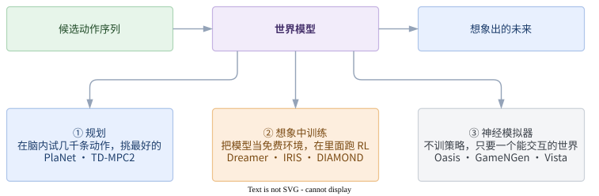

<!-- 源文件: figures/wm-three-uses.drawio -->

第 ② 条是最诱人的：真实世界里采一条数据可能要几秒钟、磨损一台机器人、或者撞一辆车；而在模型里采一条数据只要几毫秒。Dreamer 和 IRIS 的全部样本效率优势都来自这一点。

难点也只有一个：**模型会出错，而错误会累积**。你让它连续预测 100 帧，第 3 帧的微小瑕疵会变成第 30 帧的满屏噪声；更糟的是，策略会专门去找模型的漏洞刷分（在模型里横着走就能拿分，真环境里直接撞墙）。后面讲的所有技术，一半是在提升预测质量，另一半是在跟这两个问题搏斗。

接下来按**"未来存在什么形式里"**分成四大类来讲。这是区分这些方法最本质的一刀：

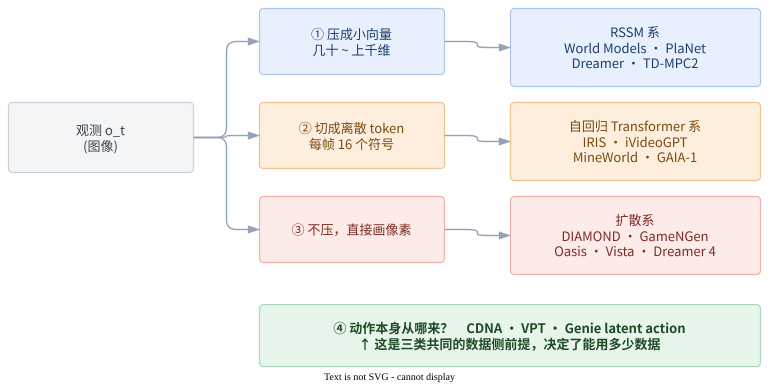

<!-- 源文件: figures/wm-taxonomy.drawio -->

---

## 第一类：把世界压成一个小向量（RSSM 系）

**核心信念**：图像有 64×64×3 = 12288 维，但真正决定未来的状态可能只有几十维（车的位置、速度、角度）。找到这个小向量，在小向量上做预测，便宜到可以随便 rollout。

### 1.1 起点：Ha & Schmidhuber 的 V-M-C（2018）

这篇把世界模型变成了一个可执行的工程范式，三个部件，分三阶段训：

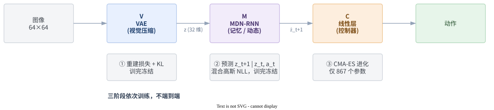

<!-- 源文件: figures/ha-vmc.drawio -->

有三个设计至今仍在影响后来者：

- **动作怎么进去**：拼接到 RNN 的输入里，`LSTM([z_t, a_t], h_t)`。最土，但也最通用，Dreamer 到今天还在这么做。
- **预测分布而不是点**：M 输出的是混合高斯（MDN），因为未来本来就不唯一。确定性模型在随机环境里只会输出一堆未来的"平均值"，也就是糊成一团。
- **温度 τ**：在"梦里"训策略时，作者发现策略学会了利用模型 bug（找到让怪物不发射火球的动作）。解法是从 MDN 采样时把方差放大（τ≈1.15），**故意让梦变得更不确定**，策略就不敢依赖那些细节了。这是 model exploitation 问题的第一次正面处理。

局限也很清楚：数据是**纯随机策略离线采的 10000 条**，随机策略走不到的地方模型永远不会；而且 V 和 M 分开训，视觉压缩不知道哪些细节对任务重要，小物体会被 VAE 当噪声丢掉。

### 1.2 PlaNet（2019）：RSSM 诞生，以及"不要策略"

PlaNet 修了上面两个问题，并给出了后面所有工作共用的那个模块。

**修数据**：改成 online。先随机采 5 条，然后「用当前模型规划采一条新数据 → 从 buffer 训模型 100 步」交替。模型见到的数据分布始终跟着策略走。

**修架构**：这就是 **RSSM**。关键洞见是一句很朴素的话——纯确定性 RNN 没法表达随机性，纯随机状态空间模型记不住长期信息，所以**两个都要**：

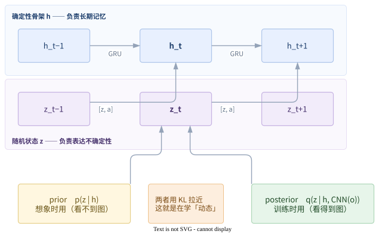

<!-- 源文件: figures/rssm.drawio -->

训练目标是 ELBO（重建图像 + 预测奖励 − KL），外加本文的方法贡献 **latent overshooting**：标准 ELBO 只训了"prior 走一步"，但推理时 prior 要连走十几步。于是额外要求"从 $t-d$ 连走 $d$ 步 prior"也要对齐 $t$ 时刻的 posterior。因为是在隐空间里多跑几遍、不用解码图像，所以很便宜。

**最特别的是没有策略网络**。每一个真实时间步都现场跑一次 CEM 搜索：采 1000 条候选动作序列 → 在隐空间 rollout 12 步 → 用奖励头累加打分 → 留最好的 100 条重新拟合分布 → 迭代 10 次 → 执行第一个动作，剩下的扔掉。

这里有个很重要的工程细节：**rollout 时不解码图像**。图像解码只在训练时用来提供学习信号，规划时全程在小向量上做，所以 1000×12 步的搜索才跑得起来。

### 1.3 Dreamer v1/v2/v3（2020–2023）：把 CEM 换成学出来的策略

PlaNet 每步重新搜索一遍，很浪费——搜索结果没有被积累下来。Dreamer 的改动是：**既然有了可导的模型，就在模型里训一个策略**。

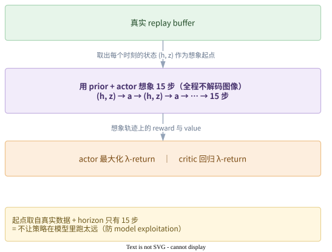

<!-- 源文件: figures/dreamer-imagination.drawio -->

三代的演进，每一代都在解决上一代暴露的具体问题：

| | 主要改动 | 为什么 |
|---|---|---|
| **v1** | 价值梯度**直接穿过**想象轨迹反传（动态、奖励头、critic 全可导，用 reparameterized 动作） | 比 REINFORCE 方差小得多，这是 v1 能用 15 步想象训出策略的原因 |
| **v2** | 隐变量从高斯换成 **32 组 × 32 类的离散分布**（straight-through 梯度）；**KL balancing** | Atari 的未来是离散多模态的（敌人出现 / 不出现），高斯 prior 表达不了。KL balancing 则是把 KL 拆成两半、分别停梯度，让 prior 去追 posterior 学动态，而不是让 posterior 退化去迁就 prior |
| **v3** | **symlog** 压缩观测与回报尺度；reward/value 用 **two-hot 离散回归**；**free bits** 固定 KL 权重；**回报分位数归一化** | 全是为了"一套超参数跑 150+ 个任务不用调"。效果是在 Minecraft 上无课程、无人类数据挖到了钻石 |

v2 的离散动作没法 reparameterize，所以 actor 退回 REINFORCE，这点常被忽略。v3 的那堆技巧看起来很杂，但指向同一件事：**让不同任务的数值尺度对齐**，这样超参数才有可能通用。这也是 DreamerV3 影响力最大的地方——它把世界模型从"每个任务调一周参"变成了"开箱即用"。

### 1.4 TD-MPC2（2024）：走到极端，连重建都不要

一个顺理成章的质问：如果我只是想选动作，为什么要花力气把图像画回来？大面积背景主导了重建损失，而真正重要的可能是远处那个 3 像素的目标。

TD-MPC2 的答案是**完全砍掉 decoder**：

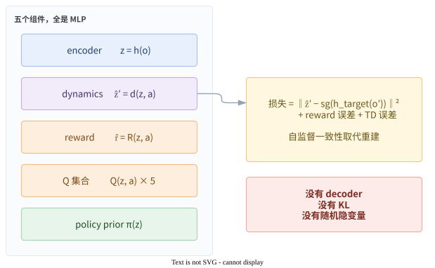

<!-- 源文件: figures/tdmpc2-components.drawio -->

不重建却不塌缩，靠两件事：target encoder 的 EMA（BYOL 那一套）+ 一个叫 **SimNorm** 的归一化（把 latent 分组后逐组 softmax）。

规划上它把 PlaNet 和 Dreamer 缝起来了：**用 MPPI 搜索，但 horizon 只有 3 步，第 3 步之后直接用学出来的 Q 当终值**。短视界 + 学出来的终值，既避免了长 rollout 的误差累积，又没丢掉长期信息。再加上一部分候选动作直接从 policy prior 采，搜索收敛得很快。

代价是：**它不再是生成式世界模型**。你没法用它看未来、没法做视频预测、没法把它当模拟器给别人用。它只是一个"对决策有用的压缩"。这条线和下面两类的分叉就在这里——如果你想要的是一个能看、能玩、能交互的世界，就必须把像素还回来。

> 这一类的共同软肋：**小物体和稀有事件会被压缩掉**。DIAMOND 那篇论文的标题就是在打这个点——*Visual Details Matter*。

---

## 第二类：把世界切成离散符号（自回归 Transformer 系）

**核心信念**：既然 GPT 能把语言建模成"预测下一个 token"，那把画面也切成 token，世界模型就变成了一个 GPT 问题——而且**动作天然就是序列里的一个 token**。

### 2.1 IRIS（2023）：最干净的一版

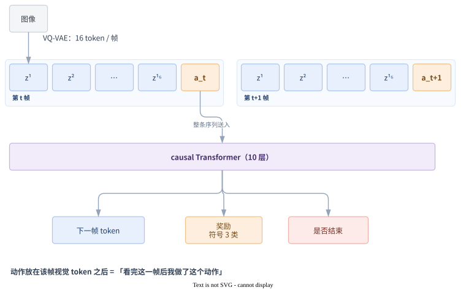

<!-- 源文件: figures/iris-sequence.drawio -->

这个排法的优雅之处：动作和画面在同一个序列里，用同一套 attention 处理，不需要为"怎么注入动作"专门设计模块。注意细节：动作放在该帧视觉 token **之后**，表示"看完这一帧后我做了这个动作"，于是下一帧 token 自然地条件于 (历史画面, 历史动作)。

训练上 tokenizer 和世界模型**分开优化**，不共享梯度——这样视觉表征不会跟着动态模型漂移。tokenizer 的损失里加了 **LPIPS 感知损失**，这对保住小物体很关键（纯 L2 会把小物体当噪声抹掉）。

图里那三个头都是**逐步预测**，而且全部用交叉熵。其中「奖励」这一项 IRIS 做得很糙：它只预测奖励的**符号**，离散成 {−1, 0, +1} 三类（代码里就是 `rewards.sign()`），想象时从这个三类分布里采样出 r̂ 再累成 λ-return。好处是把不同游戏的奖励尺度一刀切平，代价是模型分不清"吃一个豆子"和"过一关"。这正是后面暗线四要讲的尺度问题，IRIS 用最粗暴的办法绕开了，DreamerV3 才算正面解决。

策略学习有个容易被忽略但很聪明的地方：**actor 吃的是 tokenizer 解码回来的图像，而不是 token 或 latent**。这样策略在想象里和在真环境里看到的输入形式完全一致，迁移没有 gap。代价是想象时必须解码图像，比 Dreamer 贵。

仓库里的 `src/envs/world_model_env.py` 把世界模型包装成了标准的 `gym.Env`（`step(action)` 返回想象出的 obs/reward/done）。这个抽象值得直接搬到自己项目里——它让"换世界模型"和"换 RL 算法"彻底解耦。

### 2.2 token 预算：这条线的命门

IRIS 每帧 16 个 token。想象 20 步就是 340 个 token，还行。但如果场景复杂需要每帧 256 个 token、想象 100 步呢？attention 是平方复杂度，直接爆掉。

于是这条线后续的全部努力都在一个方向上：**每帧少用几个 token**。办法是同一个——**只编码变化量**：

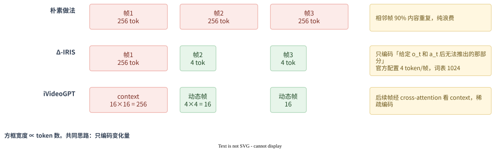

<!-- 源文件: figures/token-budget.drawio -->

Δ-IRIS 和 iVideoGPT 是同一个想法在两种规模上的实现：前者在 Atari/Crafter 上验证，后者把它推到了**百万级轨迹的预训练**。

### 2.3 iVideoGPT（2024）：解开"动作标注太少"这个死结

这里出现了全文第一次真正的范式转折。前面所有方法都是**在单个环境上从零训**，而 iVideoGPT 走的是 **大规模预训练 → 下游微调**。

问题是：带动作标注的数据极少（机器人数据集加起来也就百万级轨迹），而无动作标注的视频无穷多（YouTube）。

它的解法藏在一个实现细节里：**动作不作为独立 token，而是经线性层映射后"加到"该时刻第一个视觉 token 的 embedding 上**。

为什么这很重要？因为这样一来，**有动作和没动作可以共用同一个架构**——没有动作时这一项置零即可，序列长度完全不变。于是：

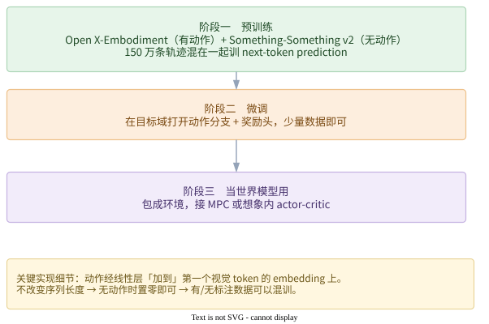

<!-- 源文件: figures/ivideogpt-stages.drawio -->

对比一下 IRIS 的"动作当一个 token"：那个方案更优雅，但要求每一帧都必须有动作标注。iVideoGPT 的 additive conditioning 看起来更土，却换来了能吃无标注视频的能力。**这是一次有意识的优雅性让渡。**

### 2.4 GAIA-1 与 MineWorld：两个工程化变体

- **GAIA-1**（Wayve，驾驶）把这条路线推到了极致：**把一切都离散化**——图像、转向角、速度、文本，全变成 token，塞进一个 9B 的自回归 Transformer。但它多了一步：预测出的 token 不直接解码，而是交给一个**视频扩散 decoder** 渲染成高清视频。这个"**Transformer 管动态、扩散管渲染**"的分工后来被很多工作沿用，因为它正好补上了 VQ token 保真度不足的短板。

- **MineWorld**（微软）是这一类里**唯一训练代码完全开源**的。它的贡献偏工程但很实用：**Diagonal Decoding**——利用"同帧内空间相邻 token 相关、跨帧可并行"的结构，沿对角线方向并行解码，把自回归生成从龟速拉到 4~7 FPS，够实时交互。另外它的评测方式值得抄：用一个 **IDM（逆动力学模型）从生成的视频里反推动作**，再和给定动作比对，这是衡量"模型到底有没有听指令"最靠谱的自动指标。很多工作只报 FVD，那只说明画得像，不说明可控。

---

## 第三类：干脆直接画出来（扩散系）

**核心信念**：压缩会丢细节，离散化会丢细节，而细节恰恰决定胜负。既然图像生成领域已经被扩散模型占领了，为什么不直接用它当世界模型？

### 3.1 DIAMOND（2024）：细节真的重要

DIAMOND 和 IRIS 出自同一批作者，可以看成一次严格的对照实验：**同样的 RL 循环，只把世界模型从"VQ token + GPT"换成"像素空间扩散"**。

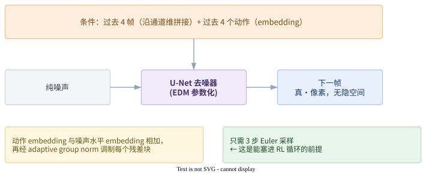

<!-- 源文件: figures/diamond-diffusion.drawio -->

结果：Atari 100k 上人类归一化分数从 IRIS 的 1.046 提到 **1.46**。定性分析显示收益主要来自子弹、远处敌人这些小而关键的东西被保住了——正是 VQ tokenizer 最容易丢的部分。

两个关键技术决定了它能不能用：

- **为什么用 EDM 而不是 DDPM**：EDM 的预条件参数化让**极少步采样依然稳定**。这不是审美选择，而是可行性前提——如果每帧要 50 步去噪，想象 15 步就是 750 次网络前向，RL 循环直接跑不动。
- **历史帧加噪**：训练时给作为条件的过去帧也加少量噪声。因为推理时模型看到的历史帧是**它自己生成的、带瑕疵的**，而训练时看到的是干净的真实帧——这个错配（exposure bias）就是自回归漂移的根源。让它在训练时就习惯"脏历史"，漂移问题大幅缓解。

另外它还顺手证明了一件事：同一个扩散世界模型，拿 **95 小时人类 CS:GO 录像纯离线训练**，不接 RL，就是一个能用键鼠实时玩的神经游戏引擎。这直接通向下一节。

### 3.2 GameNGen / Oasis：当世界模型只为了"好玩"

这里目标变了：**不训策略，只要一个能交互的世界**。评价标准从"下游 RL 得分"变成"画得像不像 + 听不听指令 + 够不够快"。

**GameNGen**（Google，DOOM）的做法是改造 Stable Diffusion 1.4：去掉文本条件，换成「过去 N 帧 latent 通道拼接 + 过去 N 个动作加到 timestep embedding」。数据是**先训一个 RL agent 去玩，录下它的全部轨迹**——用 agent 而非人类采集，保证覆盖面且可以无限生成。

它的关键技巧 **noise augmentation** 和 DIAMOND 的"历史帧加噪"是同一件事，而且更进一步：把噪声强度本身也作为条件输入模型。消融实验显示去掉它之后几十帧就崩。人类评测者在 1.6~3.2 秒的短片段上已经分不出真假。

**Oasis**（Decart/Etched，Minecraft）换了个思路对付同一个问题。它用 **Diffusion Forcing**：训练时序列里**每一帧独立采样噪声水平**。

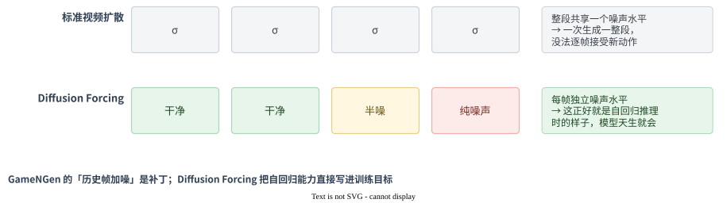

<!-- 源文件: figures/diffusion-forcing.drawio -->

相比 GameNGen 的"加噪增强"是个补丁，Diffusion Forcing 把自回归能力**直接写进了训练目标**。这是更干净的解法，Dreamer 4 后来也是走这条路。

这一类有一个容易踩的硬约束，值得单独强调：

> **不能做时间维压缩。** latent 必须逐帧对应原始帧，否则无法每帧接受一个新动作。而市面上绝大多数现成的视频 VAE 都带 4× 或 8× 时间压缩——拿来就用会发现模型根本不响应动作。Oasis 专门用了只做空间压缩的 VAE。

### 3.3 Vista（2024）：驾驶场景，以及"大数据学动态、小数据学控制"

驾驶是这套东西最有落地动机的地方，因为"给定一条候选轨迹，预测接下来会发生什么"正好就是规划需要的输入。

Vista 面对一个很现实的矛盾：**带 ego 动作标注的驾驶数据很少**（nuScenes 只有 5.5 小时），**无标注驾驶视频极多**（OpenDV-YouTube 有 1700+ 小时）。它的解法是把训练**解耦成两阶段**：

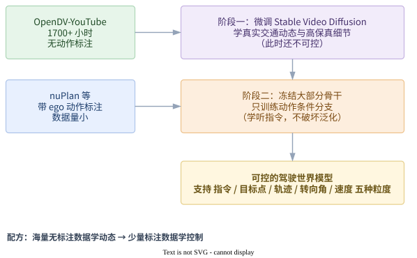

<!-- 源文件: figures/vista-two-stage.drawio -->

这个"**海量无标注数据学动态 → 少量标注数据学控制**"的配方，现在是驾驶世界模型的通用做法。单独用 nuScenes 训必然过拟合。

它的动作条件设计也值得抄：**同时支持 5 种粒度**——高层指令（左/直/右）、目标点、未来轨迹、转向角、速度。训练时**随机丢弃/选择其中一种**（classifier-free 风格的条件 dropout），于是推理时可以只给任意一种。规划器有轨迹就给轨迹，只有意图就给指令。

两个工程细节：
- **长程续推用 latent 级续接**：单次只能生成 25 帧，续推时把上一段末尾几帧的 **latent** 直接当作下一段的条件，而不是解码成像素再重新编码——避免 VAE 编解码误差累积。
- **世界模型可以当奖励函数用**：不需要真实动作标签，给定一个候选动作，看模型对该条件下预测的不确定性/似然，就是这个动作的评分。注意这里的"奖励"和前面各节的**奖励头**不是一回事——它并不预测环境奖励（驾驶本来也没有任务奖励可用），这个分数是从模型自身的置信度里借出来的。

### 3.4 Dreamer 4（2025）：三条线在这里收拢

Dreamer 4 是个很好的收尾，因为它把前面三类的技术全部吸收了：

| 来自 | 技术 |
|---|---|
| 扩散系 | latent 上的扩散生成 + Diffusion Forcing 的独立噪声水平 |
| token 系 | tokenizer + Transformer 骨干，block-causal attention（帧内双向、帧间因果） |
| RSSM 系 | 想象内 actor-critic、λ-return —— 整套 Dreamer 行为学习原封不动 |
| 新增 | **shortcut forcing**：把"一步跨过多个去噪步"的能力写进训练目标，做到 ~4 步生成、接近实时 |

而它真正的突破在数据设定上：**纯离线**。只给 2500 小时 Minecraft 人类录像，训出世界模型，然后**完全在想象里**训策略，策略直接拿到真环境用。对比 DreamerV3 挖钻石需要 1 亿步在线交互——这是从"模型帮我省样本"到"**我压根不需要环境**"的质变。

另一个姿态上的变化：policy head 和 reward head **直接长在世界模型的 backbone 上**，共享表征，而不是另起一个网络。"把 agent 训在世界模型里面"这个标题是字面意思。

> 官方代码未发布。想看架构可以读 `lucidrains/dreamer4`，它带一个 action-conditioned moving-MNIST 的最小示例，单卡几小时就能看到"模型确实跟着动作走"，适合做理解的 sanity check。

---

## 第四类：动作本身从哪来（数据侧的暗线）

前三类讲的都是"怎么建模"。但有个更根本的问题一直被绕着走：**$a_t$ 这个标注，谁给你？**

这条暗线决定了世界模型能有多大，所以单独拎出来讲。

### 4.1 最早的日子：动作是免费的

Oh et al. (2015) 用 DQN 玩 Atari 顺手录下动作；Finn et al. 的 CDNA 用机械臂随机推东西，动作就是发给机器人的指令。在这些设定里动作标注**自动就有**，因为是自己采的数据。

顺便说，这两篇留下的技术至今还在用：
- Oh et al. 的**乘法式动作交互**（$h' = W(h \odot W_a a)$，而非简单拼接），在离散动作上比 concat 更有效
- CDNA 的**动作 tile 成特征图再拼接**，是卷积模型注入低维动作的标准做法
- 两篇都用了**多步 curriculum + scheduled sampling**，这是对抗漂移的最早手段
- CDNA 的"**预测像素怎么搬运，而不是直接回归像素**"（预测卷积核 + mask 来 warp 上一帧），这个 motion-centric 思路后来在驾驶世界模型里以光流和占据栅格的形式复活了

但自采数据的规模上限就是你的交互预算。想要互联网规模的数据，就撞上了墙：**YouTube 上的视频没有动作标注**。

### 4.2 三种破局方式

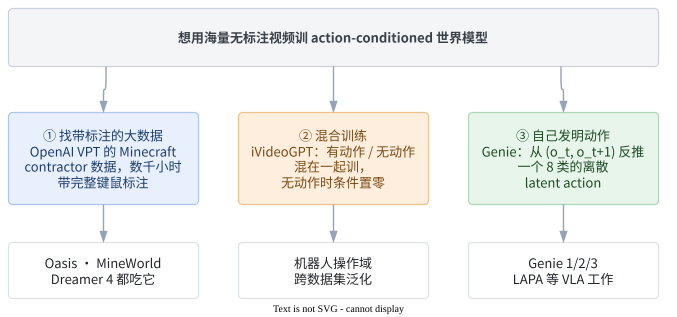

<!-- 源文件: figures/action-label-three-ways.drawio -->

第 ③ 条最值得讲。**Genie 的 latent action** 是这样工作的：

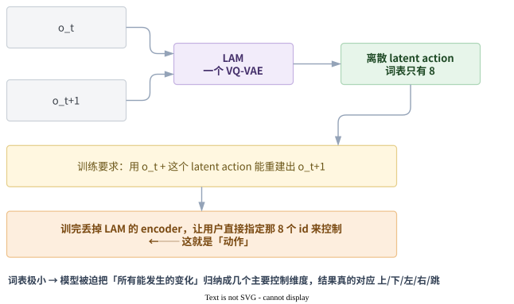

<!-- 源文件: figures/genie-latent-action.drawio -->

因为词表极小（|A|=8），模型被迫把"所有能发生的变化"归纳成几个最主要的控制维度——结果学出来的东西真的对应"上/下/左/右/跳"这类语义。于是 **20 万小时完全无标注的平台游戏视频，变成了可控的训练数据**。

这个想法解开了领域里最紧的那个结，影响已经溢出到机器人（用 latent action 从人类操作视频里学 VLA）。一个实用的近似替代是：**先用少量标注数据训一个 IDM（逆动力学模型），再拿它给海量无标注视频打伪动作标签**——VPT 本身就是这么做出来的。

### 4.3 驾驶的特殊情况：动作有很多种粒度

驾驶这边动作标注不算稀缺（车队有 CAN 总线数据），但有个别的问题：**"动作"到底指什么？** 规划器可能输出一条完整轨迹，也可能只有一个"右转"的意图。

Vista 的多模态动作 + 条件 dropout 就是为这个设计的。这里的教训值得记住：**动作条件不要只做一种形式**，否则你的世界模型只能对接一种规划器。

---

## 四条暗线：换个角度看同一批论文

按类别讲完了，但真正把这些论文串起来的是几个**反复出现的技术问题**。同一个问题在不同类别里被反复解决，解法之间能互相启发。

### 暗线一：自回归漂移（exposure bias）

训练时模型看的是干净的真实历史，推理时看的是自己生成的脏历史。这个错配让长 rollout 必然崩。

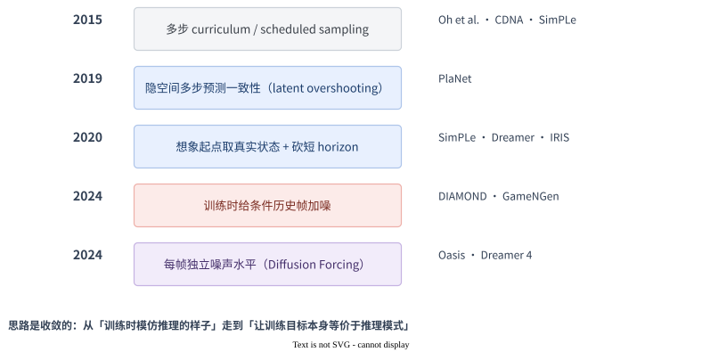

<!-- 源文件: figures/drift-timeline.drawio -->

注意这是**同一个问题的五代解法**，而且思路是收敛的：从"训练时模仿推理的样子"（curriculum）走到"让训练目标本身就等价于推理模式"（Diffusion Forcing）。

### 暗线二：model exploitation（策略钻模型的漏洞）

只在第 ② 种用法（想象中训策略）里出现，但一旦出现就很致命。

| 年份 | 做法 | 代表 |
|---|---|---|
| 2018 | 采样时放大方差（温度 τ=1.15），让梦更不确定 | Ha & Schmidhuber |
| 2020 | 想象 horizon 砍到 15~20 步，起点取真实状态 | SimPLe · Dreamer · IRIS |
| 2020+ | online 交替采集：策略去哪钻漏洞，就在那里补真实数据 | Dreamer · IRIS · DIAMOND |
| 2024 | horizon 只留 3 步，之后交给学出来的 Q | TD-MPC2 |

核心都是**不让策略在模型里跑太远**。Dreamer 4 的纯离线设定下没法补数据，所以它更依赖世界模型本身的质量——这也是为什么它必须把模型做得那么大。

### 暗线三：动作注入在哪一层

这是复现时最容易抄错、却最少被论文强调的地方。

| 做法 | 适用架构 | 代表 | 备注 |
|---|---|---|---|
| 拼进 RNN 输入 | RSSM | PlaNet, Dreamer | 最通用 |
| 乘法交互 $h \odot W_a a$ | 卷积 | Oh et al. 2015 | 离散动作上优于 concat |
| tile 成特征图再拼接 | 卷积 | CDNA, SimPLe | 低维动作进卷积网的标准做法 |
| **当成序列里一个 token** | Transformer | IRIS, MineWorld | 最优雅，但要求每帧都有标注 |
| **加到视觉 token 的 embedding 上** | Transformer | iVideoGPT | 不改序列长度，**可与无动作数据混训** |
| 加到 timestep embedding / adaLN | U-Net, DiT | DIAMOND, GameNGen, Oasis | 扩散系默认做法 |
| 经 MLP 后 cross-attention | 视频扩散 | Vista | 支持多种动作模态并存 |

IRIS 和 iVideoGPT 的那组对比最有意思：一个为了优雅把动作当独立 token，一个为了能吃无标注数据牺牲优雅改成相加。**架构选择是被数据策略倒逼的**，不是纯粹的审美问题。

### 暗线四：尺度对齐与"不用调参"

一条很不显眼但极重要的线。不同任务的奖励尺度、观测尺度差几个数量级，是世界模型长期需要逐任务调参的根本原因。

| 方法 | 技术 | 覆盖范围 |
|---|---|---|
| DreamerV2 | 离散隐变量 + KL balancing | 修的是分布层面的尺度问题 |
| DreamerV3 | symlog + two-hot + free bits + 回报分位数归一化 | 一套超参跑 150+ 任务 |
| TD-MPC2 | SimNorm + two-hot 离散回归 | 一套超参跑 545 个任务 |

DreamerV3 和 TD-MPC2 虽然属于不同类别，却**不约而同地把"回归"换成了"离散分类"**（two-hot）。回归重尾分布不稳定，分类稳定——这个经验现在基本是共识了。

---

## 全景时间线

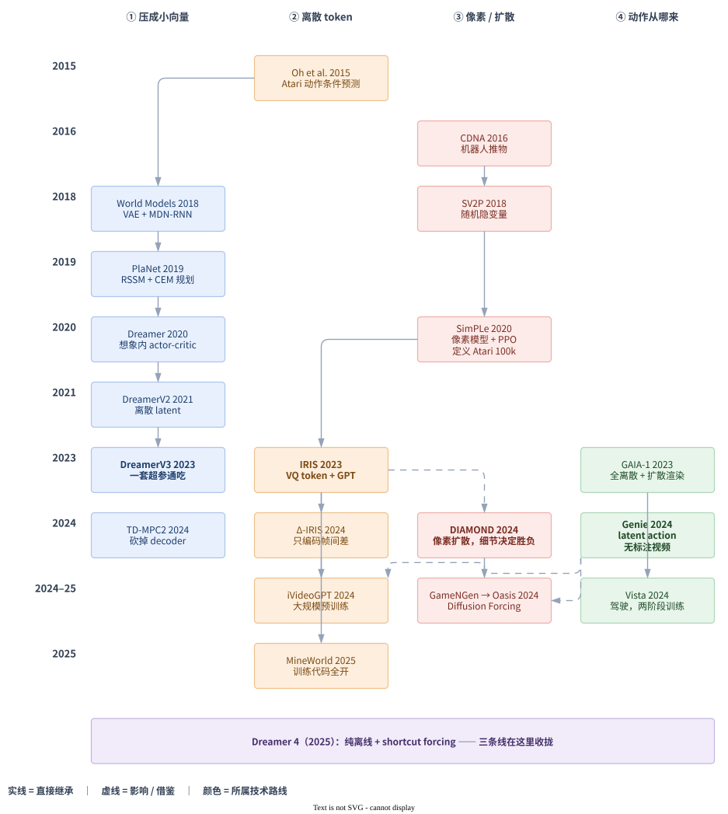

<!-- 源文件: figures/genealogy.drawio -->

---

## 一句话版本

| 类别 | 一句话 | 代价 |
|---|---|---|
| 压成小向量（RSSM） | rollout 便宜到可以在里面跑 RL | 小物体和细节被压没 |
| 离散 token | 复用 LLM 全套基建，动作就是一个 token | token 预算是硬约束；保真度不如扩散 |
| 扩散 | 视觉保真度最高，多模态未来自然 | 慢；必须想办法做到少步生成 |
| 动作从哪来 | 决定了能用多少数据，也就决定了天花板 | — |

三类之间的张力可以归结成一个权衡：**压缩得越狠，rollout 越便宜但细节越少；保留得越多，画得越真但越跑不动。** 从 PlaNet 到 DIAMOND 是朝一个方向走，从 DIAMOND 的 3 步采样到 Dreamer 4 的 shortcut forcing 是在往回找平衡。

---

## 动手建议

想自己跑一遍，按这个顺序：

1. **`lucidrains/dreamer4` 的 moving-MNIST 示例** — 单卡几小时，先亲眼看到"给不同动作，模型画出不同未来"。理解 action conditioning 最快的方式。
2. **IRIS** — 单卡能跑完整 Atari 100k，代码干净。重点读 `src/envs/world_model_env.py`（世界模型包装成 gym.Env）和 `src/models/world_model.py`。
3. **DIAMOND** — 和 IRIS 对照着看，架构换了但 RL 循环几乎一样。跑 `src/play.py` 可以手动在学到的世界模型里玩，很直观。
4. **dreamerv3-torch**（NM512）— RSSM 必读，比官方 JAX 版好懂。看 `models.py` 里的 `WorldModel` 和 `ImagBehavior`。
5. 之后按方向分流：机器人 → **iVideoGPT**（有预训练权重）；游戏 → **MineWorld**（训练代码全开）；驾驶 → **Vista**（建议用放出的权重微调动作分支，不要从头复现）。

三个最常见的坑：

- **continue / done 预测没训好** → 想象轨迹跨过回合边界，value 直接爆炸。这是复现 Dreamer 系最高频的失败原因。
- **拿现成视频 VAE 做交互式世界模型** → 大部分都有 4×/8× 时间压缩，latent 和原始帧不是逐帧对应的，模型会完全不响应动作。
- **只看 FVD/PSNR 评估** → 那只说明画得像。动作一致性要单独测（用 IDM 从生成视频反推动作，和给定动作比对）。

---

> 逐篇的数据/架构/训练细节和代码入口见 `notes/00` ~ `notes/12`，横向对比表见 `README.md`。
