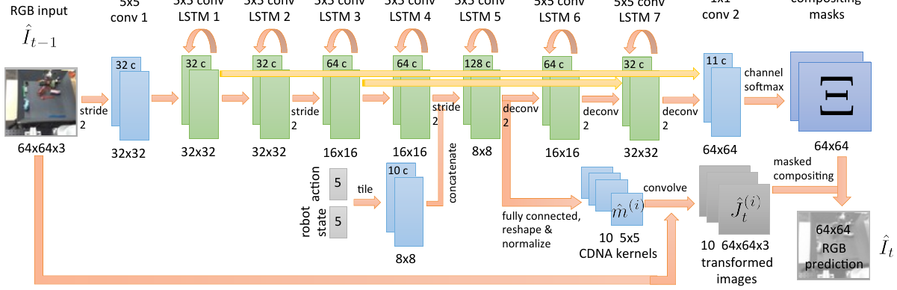

# 01 — 经典 Action-Conditional 视频预测（世界模型的前身）

这三篇不自称"世界模型"，但定义了"给定动作预测下一帧"这个任务形式，后面所有工作都在它们的框架里。

---

## 1.1 Oh et al. 2015 — Action-Conditional Video Prediction using Deep Networks in Atari Games

- 论文：NeurIPS 2015, arXiv:1507.08750
- 代码：`https://github.com/junhyukoh/nips2015-action-conditional-video-prediction` (Caffe)

**数据**：Atari (ALE) 5~8 个游戏，用训练好的 DQN 以 ε-greedy（ε≈0.2~0.3）采集，每游戏约 50 万~100 万帧。输入 4 帧灰度 84×84 堆叠。

**架构**：两个变体（原文 Figure 1，架构细节在附录 Figure 9）

- **feedforward**：CNN encoder → 特征 h → 乘法动作交互 → deconv 解码下一帧
- **recurrent**：encoder → LSTM → 同样的乘法交互 → deconv。长程预测更稳

**乘法式动作交互**（本文最有生命力的贡献）。编码特征与动作不是拼接，而是逐元素相乘：

$$h^{dec}_{t,i} = \sum_{j,l} W_{ijl}\, h^{enc}_{t,j}\, a_{t,l} + b_i$$

这是个 3-way tensor，参数量 $n \times n \times |A|$ 不可扩展，所以论文做了**因子分解**：

$$h^{dec}_t = W^{dec}\big(W^{enc} h^{enc}_t \odot W^{a} a_t\big) + b$$

即「视觉特征过一个线性层」与「动作过一个线性层」做 **element-wise 乘积**，再过一个线性层。这样参数量降到 $O(nf)$，而且**不同动作之间共享权重**。

直觉：动作在这里起"门控"作用——它决定哪些视觉特征通道被放大。相比 concat（动作只是加性偏置），乘法能表达"同一个视觉特征在不同动作下导致不同后果"。在离散动作上实测优于 concat，这个结论至今成立。

**训练**：
- 纯监督 L2 重建，**多步展开 curriculum**：先训 1 步，再 3 步、5 步
- 这是**最早的 multi-step curriculum**，后来 PlaNet 的 latent overshooting、SimPLe 的 scheduled sampling 都是同一思路
- 下游：把预测器当模拟器做 informed exploration，略微提升 DQN

---

## 1.2 Finn et al. 2016 — CDNA / Unsupervised Learning for Physical Interaction through Video Prediction

- 论文：NeurIPS 2016, arXiv:1605.07157
- 代码：`https://github.com/tensorflow/models/tree/archive/research/video_prediction`
- 数据集：**BAIR / Google robot pushing**，59k 条机械臂随机推物体序列（真实机器人自采，无人工标注）

<small>原文 Figure 1，Finn, Goodfellow, Levine, *Unsupervised Learning for Physical Interaction through Video Prediction* (arXiv:1605.07157)。版权归原作者，此处为学习笔记引用。</small>

**怎么读这张图**（这张图把 motion-centric 的思路画得非常清楚）：

- 主干是一串 **conv + Conv-LSTM**（图中 LSTM 1~7），分辨率 64×64 → 32×32 → 16×16 → 8×8 再上采回去，带 skip connection（上方的长弧线）
- 中部下方有一个小分支：**`robot state` 和 `action` 先 tile 成特征图**，再 concat 进 8×8 的那一层（图中标了 `tile`）。这是卷积模型注入低维向量的标准做法
- 从 LSTM 5 旁边引出 **`10 5x5 CDNA kernels`**：网络不直接输出像素，而是输出 **10 个 5×5 的卷积核**
- 这 10 个核分别作用于上一帧，得到 **`10 64x64x3 transformed images`**
- 同时主干末端输出 **`compositing masks`**（11 通道，经 channel softmax），把 10 张变换图 + 1 个静态背景按 mask 加权合成，得到最终预测 `Î_t`

**三种变体**：

| 变体 | 预测什么 | 含义 |
|---|---|---|
| **DNA** | 每个像素一个局部采样分布（5×5） | 逐像素独立搬运，最灵活 |
| **CDNA** | 10 个**全局** 5×5 卷积核 + mask | 把场景分解为若干刚体运动 |
| **STP** | 若干组仿射变换参数 | 运动被约束为仿射 |

CDNA 的归纳偏置最有意思：**10 个全局核 ≈ 假设场景里最多有 10 种不同的运动模式**（机械臂、被推的物体、背景各算一种）。这比逐像素预测更省、更容易泛化到没见过的物体。

**训练**：L2（或 L1）重建 + **scheduled sampling** 逐步切换到自回归输入。纯监督，无 RL。

**后续**：SNA（Ebert et al.）加遮挡处理；**Visual Foresight / Visual MPC** 把它接上 CEM planner 做真机操作，是"用世界模型做机器人控制"的开山之作。

---

## 1.3 Babaeizadeh et al. 2018 — SV2P: Stochastic Variational Video Prediction

- 论文：ICLR 2018, arXiv:1710.11252
- 代码：在 `tensor2tensor` 里（`tensor2tensor/models/video/sv2p.py`）

**动机**：确定性模型在随机环境里会输出模糊的平均帧。引入 per-sequence 隐变量 $z$。

**架构**：CDNA 骨干 + 一个推断网络 $q(z\mid o_{1:T})$ 产出**时间不变**的隐变量，和动作一起注入 CDNA。

注意是"时间不变"：整条序列共享一个 $z$，代表"这次 rollout 里物体会往哪个方向滚"这类全局不确定性。这比每步一个 $z$ 更容易训，但表达力弱（没法表达中途突然出现的事件）。

**训练**：三阶段 schedule（关键，否则 posterior collapse）：
1. 只训确定性部分（KL 权重 0，推断网络不参与）
2. 打开推断网络但 KL 权重仍为 0
3. 逐步 anneal KL 权重上去

这套 schedule 很脆弱——**这正是 SimPLe 改用离散 bit 隐变量的原因**（离散版不需要 annealing）。

**地位**：SimPLe 的世界模型就是 SV2P 这条线的直接产物。

---

## 共同遗留

这三篇留下的东西，在今天的世界模型里仍然能一一对应：

| 这三篇的做法 | 现在在哪 |
|---|---|
| 乘法式动作交互 | 仍是离散动作的强基线；adaLN 调制本质上也是乘法门控 |
| 动作 tile 成特征图再 concat | 卷积类世界模型的默认做法（SimPLe、早期驾驶模型） |
| 多步 curriculum / scheduled sampling | → latent overshooting → 历史帧加噪 → Diffusion Forcing |
| 必须显式建模随机性 | → 离散 bit（SimPLe）→ categorical latent（DreamerV2）→ 扩散噪声 |
| 预测运动而非像素（motion-centric） | 在驾驶世界模型里以光流、占据栅格的形式复活（OccWorld 一脉） |
| 动作标注是免费的（自采数据） | 这个前提在互联网规模数据上失效，于是有了 Genie 的 latent action（note 10） |
