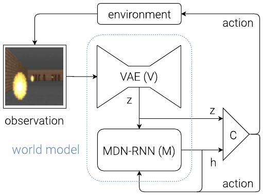
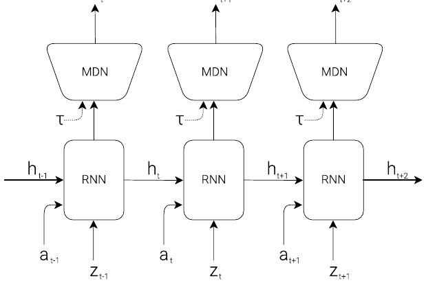

# 02 — World Models (Ha & Schmidhuber, 2018)

- 论文：arXiv:1803.10122，交互版 https://worldmodels.github.io
- 官方代码：`https://github.com/hardmaru/WorldModelsExperiments` (TF1 + estool/CMA-ES)
- 推荐 PyTorch 复现：`https://github.com/ctallec/world-models`（代码短，单卡能跑通 CarRacing）

"V-M-C" 三件套，是 action-conditioned 世界模型的范式奠基作。



<small>原文 Figure 8，Ha & Schmidhuber, *World Models* (arXiv:1803.10122)。版权归原作者，此处为学习笔记引用。</small>

**怎么读这张图**：虚线框是「world model」，只包含 V 和 M，**C 在框外**——这是全文最重要的结构信息。observation 先过 VAE 得到 `z`，`z` 和 M 的隐状态 `h` 一起喂给 C（图中最右的小梯形），C 输出 action。action 有两条去向：一条回到 environment，一条回到 MDN-RNN 当作下一步预测的条件。注意 **C 同时看 z 和 h**，这点在论文的消融里很关键（只看 z 的话 CarRacing 开起来会发抖，见原文 Figure 11）。

## 数据

两个任务：
- **CarRacing-v0**（连续动作 3 维：转向/油门/刹车）
- **VizDoom TakeCover**（离散动作：左/右）

采集方式是这篇最特别的地方：**用纯随机策略离线采 10000 条 rollout，一次采完，之后再也不碰真环境采数据**。CarRacing 的 controller 仍在真环境里评估（CMA-ES 需要适应度），Doom 版本则完全在 dream 里训练，只在最后迁移回真环境测试。

- 帧 resize 到 64×64×3
- 存成 `.npz`，每条 rollout 存 (obs, action, reward, done)
- CarRacing 每条 rollout 上限 1000 步；Doom 版还要存 done 标记用于训练终止预测

这是和后面 PlaNet/Dreamer 最大的区别：**它是离线单轮，后者是 online 迭代**。随机策略覆盖不到的状态空间，模型就永远不会。CarRacing 里随机策略基本只在起跑线附近打转，所以 M 对高速过弯的动态其实学得很差——这也是为什么 C 必须在真环境里评估。

## 架构

### V — Vision：卷积 VAE

```
输入 64×64×3
  conv 32,  k4 s2, ReLU   -> 31×31
  conv 64,  k4 s2, ReLU   -> 14×14
  conv 128, k4 s2, ReLU   -> 6×6
  conv 256, k4 s2, ReLU   -> 2×2
  flatten 1024 -> μ (32), logσ (32)
z ~ N(μ, σ)                        z ∈ R^32
  反向对称 deconv -> 64×64×3, sigmoid
```

损失：像素 L2 重建 + KL。Doom 版对 KL 做了下界裁剪（free-bits 风格），防止 posterior collapse。

### M — Memory：MDN-RNN



<small>原文 Figure 6，Ha & Schmidhuber, *World Models* (arXiv:1803.10122)。版权归原作者，此处为学习笔记引用。</small>

**怎么读这张图**：横向是时间展开的 LSTM，每步输入 `[z_t, a_t]`（图中下方两个箭头），隐状态 `h` 往右传。往上输出的不是 `z_{t+1}` 本身，而是经过 MDN 头得到的**混合高斯参数**，再采样出 `z_{t+1}`。那个 **τ 就是温度**，卡在 MDN 和采样之间——这是"在梦里训练"一节的核心旋钮。

- LSTM hidden 256
- 输入：`[z_t, a_t]` 拼接（CarRacing 是 32+3=35 维）
- 输出：**5 个高斯分量**的 (π, μ, σ)，即 `p(z_{t+1} | z_t, a_t, h_t)`；Doom 版额外输出 done 的 logit
- MDN 的动机：环境随机性（Doom 里怪物何时发射火球）。确定性回归只会输出所有可能未来的均值，糊成一团

### C — Controller：**线性层**

$$a_t = W_c\,[z_t\;h_t] + b_c$$

- CarRacing：输入 32+256=288 维，输出 3 维 → **867 个参数**
- 故意做到极小，这样才能用进化算法训，且不会"记住"训练轨迹

## 训练方法

严格三阶段，不端到端：

```
1. 用随机 rollout 训 VAE（只用图像，完全忽略动作）
2. 冻结 VAE，把所有帧编码成 z 序列，训 MDN-RNN 预测 z_{t+1} | z_t, a_t
3. 冻结 V 和 M，用 CMA-ES 在 [z, h] 上进化线性 controller
```

**为什么分阶段而不是联合训**：那个年代还没有稳定的端到端方案，而且分阶段让每一步都可独立调试。代价是 **V 不知道哪些视觉细节对任务重要**——重建损失被大面积背景（赛道外的草地）主导，小物体会被当噪声丢掉。Dreamer 的端到端联合训练就是在修这个。

### CMA-ES 细节

- population 64
- 每个个体跑 16 条 rollout 取平均 return（CarRacing 的 reward 噪声大，不平均的话排序全是噪声）
- 多进程/多机并行，论文用了 64 核
- 不需要梯度 → reward 可以不可导、episode 可以很长、可以直接优化"通关率"这类指标

### "在梦里训练"（Doom 实验，本文最有名的部分）

Controller 完全在 MDN-RNN 的 rollout 里训练，**不接触真环境**，最后迁移回真环境。

问题：策略会利用模型漏洞——它找到了一种动作序列，让 M 预测的怪物干脆不发射火球（原文 Figure 18 展示了这个"对抗策略"）。在梦里得分极高，真环境里一撞就死。

解法：**温度参数 τ**。从 MDN 采样时把方差乘以 τ：

| τ | 梦里得分 | 真环境得分 |
|---|---|---|
| 0.10 | 2086 | 193 |
| 0.50 | 2060 | 196 |
| **1.15** | 1086 | **1092** |
| 1.30 | 847 | 753 |

τ=1.15 时梦里和真环境的得分最接近。**故意让梦变得更不确定，策略就不敢依赖模型的细节**。这是 model exploitation 问题的第一次正面处理，后面 Dreamer 砍短 horizon、SimPLe 从真实状态重启，都是同一个思路的不同实现。

## 实现上的坑

- **MDN 的 log-sum-exp 必须做数值稳定**，否则训练中段 NaN。`ctallec/world-models` 的 `models/mdrnn.py` 里有正确写法。
- **z 的尺度**：VAE 的 KL 项会把 z 压向 N(0,1)，但如果 KL 权重太大，z 几乎不携带信息，M 就学不到动态。
- **CarRacing 的 reward 稀疏且带噪**，CMA-ES 评估不平均会完全不收敛。
- **action repeat**：论文没用，但复现时常加，会显著影响结果可比性。
- Doom 版的 **done 预测**很关键：不预测终止的话，梦里的 episode 会无限长，策略学到的行为完全失真。

## 代码入口

```
WorldModelsExperiments/carracing/
├── extract.py        # 阶段 0：随机策略采 10000 条 rollout
├── vae_train.py      # 阶段 1：训 VAE
├── series.py         # 把 rollout 编码成 z 序列（阶段 1→2 的桥）
├── rnn_train.py      # 阶段 2：训 MDN-RNN
├── train.py          # 阶段 3：CMA-ES（依赖 estool）
└── model.py          # V+M+C 的推理期组装，含温度采样
```

PyTorch 版 `ctallec/world-models` 的对应关系：`trainvae.py` / `trainmdrnn.py` / `traincontroller.py`，另有 `utils/misc.py` 里的 `RolloutGenerator` 负责把三件套串起来跑一条 rollout。
