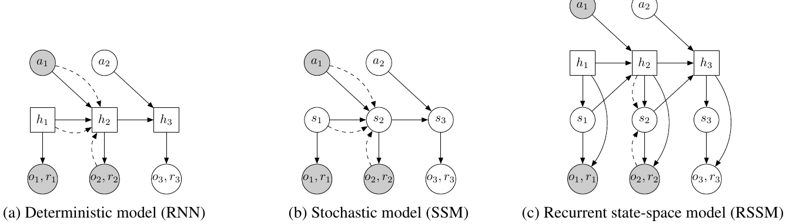

# 03 — PlaNet: Learning Latent Dynamics for Planning from Pixels (2019)

- 论文：ICML 2019, arXiv:1811.04551
- 官方代码：`https://github.com/google-research/planet` (TF1，已不维护)
- 可跑的 PyTorch 复现：`https://github.com/Kaixhin/PlaNet`

第一个把"隐空间 MPC"做到像素级连续控制 SOTA 的工作，**RSSM 的出处**。没有策略网络，纯 planning。

## 架构：RSSM 的三种设计对比



<small>原文 Figure 2，Hafner et al., *Learning Latent Dynamics for Planning from Pixels* (arXiv:1811.04551)。版权归原作者，此处为学习笔记引用。</small>

**怎么读这张图**（整篇论文的核心论证都在这里）：

- **方块 = 确定性变量，圆圈 = 随机变量**；灰底 = 观测到的量，白底 = 需要推断的量
- **实线 = 生成过程（先验），虚线 = 推断过程（后验）**
- (a) **纯确定性 RNN**：只有方块 `h`。给定动作序列，未来完全确定 → 无法表达"火球可能来也可能不来"，规划器会对一个它自己臆想的唯一未来过度自信
- (b) **纯随机 SSM**：只有圆圈 `s`。每步都要重新采样，信息无法可靠地跨多步传递 → 记不住"十步前我捡到了钥匙"
- (c) **RSSM**：`h`（方块）和 `s`（圆圈）**并存**。`h` 走确定性 GRU 负责长期记忆，`s` 挂在 `h` 上负责随机性

注意 (c) 里 `h_t` 同时指向 `s_t` 和 `h_{t+1}`，而 `s_t` 也指回 `h_{t+1}`——两条路径是耦合的，这是 RSSM 和"RNN 加个噪声"的本质区别。

形式化：

```
确定递推:   h_t = GRU(h_{t-1}, [s_{t-1}, a_{t-1}])
先验(prior): p(s_t | h_t)        = Normal(μ_p(h_t), σ_p(h_t))
后验(post):  q(s_t | h_t, o_t)   = Normal(μ_q(h_t, e_t), σ_q(·)),  e_t = CNN(o_t)
观测解码:    p(o_t | h_t, s_t)   = deconv
奖励解码:    p(r_t | h_t, s_t)   = MLP
```

网络规模：

| 组件 | 配置 |
|---|---|
| CNN encoder | 4 层 conv (32/64/128/256)，kernel 4，stride 2 → 1024 维 |
| decoder | 对称 deconv，输出 64×64×3 高斯（方差固定为 1，等价于 L2） |
| GRU hidden `h` | 200 |
| 随机状态 `s` | 30 |
| reward head | 2 层 MLP，300 单元 |
| 动作注入 | **拼接进 GRU 输入** |

**没有 policy / value 网络，也没有 done 预测**（DMC 任务定长）。

## 数据

- 环境：DeepMind Control Suite（cheetah run / walker walk / cup catch / finger spin / reacher easy / cartpole swingup），**只看 64×64 像素**，不给 proprioception
- 采集：**online**。先用随机策略采 **5 条 seed episode**，然后交替「用当前模型 planning 采一条新 episode」和「从 replay buffer 训模型 100 步」
- 总预算约 1000 episodes（≈ 比 D4PG 少 50 倍交互）
- 训练时采样长度 L=50 的 chunk，batch 50
- 观测加了少量高斯噪声做正则

**action repeat 是最关键的超参**，直接决定能不能收敛：

| 任务 | action repeat |
|---|---|
| cartpole swingup | 8 |
| reacher easy | 4 |
| cheetah run | 4 |
| cup catch | 4 |
| finger spin | 2 |
| walker walk | 2 |

复现 DMC 结果对不上，九成是这个没设对。它同时改变了有效 horizon 和数据量，所以和别的方法比较时必须对齐。

## 训练方法

### 目标函数：ELBO

$$\max \sum_t \underbrace{\mathbb{E}_q[\log p(o_t|s_t,h_t)] + \mathbb{E}_q[\log p(r_t|s_t,h_t)]}_{\text{重建}} - \underbrace{\mathrm{KL}\big[q(s_t|\cdot)\,\|\,p(s_t|h_t)\big]}_{\text{一致性}}$$

用 reparameterization，端到端反传（encoder / decoder / GRU / reward head 一起训）。

### Latent Overshooting（本文的方法贡献）

标准 ELBO 只约束 1 步 prior 对齐 1 步 posterior。但推理时 prior 要连走十几步，这个用法从没被训过。于是额外加：对每个 $d \le D$，让**从 $t-d$ 走 d 步 prior 得到的分布**去对齐 $t$ 时刻的 posterior（posterior 停梯度）：

$$\sum_{d=1}^{D}\beta_d\,\mathrm{KL}\big[q(s_t|o_{\le t})\;\big\|\;p(s_t \mid s_{t-d}, a_{t-d:t})\big]$$

实现上就是在隐空间里多跑几遍 prior，**不需要解码像素，所以很便宜**。配 **free nats**（KL 低于 3 nats 不惩罚）防止 posterior collapse。

原文 Figure 8 的消融显示：overshooting 对纯 SSM 提升巨大，对 RSSM 提升较小——因为 RSSM 的确定性通路本来就缓解了多步漂移。换句话说这两个贡献有部分重叠。

### 规划：CEM-MPC（无策略）

每个真实时间步重新做一次：

```
1. 初始化动作序列分布 N(0, I)，horizon H = 12
2. 采 J = 1000 条候选动作序列
3. 在隐空间里 rollout（不解码图像！）
4. 用 reward head 累加预测回报，取 top-K = 100
5. 用 top-K 重新拟合均值方差，回到步骤 2，迭代 I = 10 次
6. 执行均值的第一个动作，其余丢弃（receding horizon）
```

**不解码像素做 planning 是速度关键**：1000 条 × 12 步 = 12000 次隐空间转移，如果每步都要跑 deconv 生成 64×64 图像，根本跑不动。图像解码只在训练时用来提供学习信号。

原文 Figure 12 对 planner 超参做了消融：horizon 太短会短视，太长则因模型误差累积反而变差，12 附近是甜点。这个"模型误差给 horizon 设了上限"的观察，直接导致了 TD-MPC2 用学出来的 Q 当终值、把 horizon 砍到 3。

## 要点与坑

- **free nats 和 overshooting 权重都比较敏感**，去掉任一个长程预测很快发散
- **重建损失被大面积背景主导**，所以 PlaNet 对小物体（reacher 的目标球）不敏感——这个问题一路留到 DreamerV3 才靠 symlog + 更强 encoder 缓解
- **CEM 在高维动作空间会退化**：DMC 动作最多 6 维还行，到 Humanoid（21 维）就不够了，这是后来必须引入 policy prior 的原因
- 官方 TF1 代码依赖 `tensorflow-probability` 的老版本，基本装不起来；想跑建议直接用 `Kaixhin/PlaNet`

## 代码入口

```
planet/
├── scripts/train.py              # 主循环（交替采集 / 训练）
├── planet/models/rssm.py         # RSSM：prior / posterior / overshooting
├── planet/control/cem.py         # CEM planner
├── planet/control/mpc_agent.py   # 把 planner 包成 agent
└── planet/training/objectives.py # ELBO + overshooting + free nats
```

PyTorch 版 `Kaixhin/PlaNet` 全部在 `main.py` + `models.py` 两个文件里，`TransitionModel` 就是 RSSM，CEM 在 `planner.py`。
