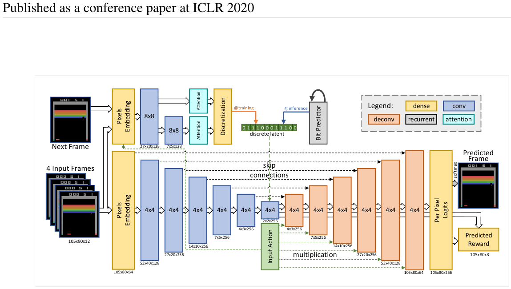

# 04 — SimPLe: Model-Based RL for Atari (2020)

- 论文：ICLR 2020, arXiv:1903.00374（Kaiser et al.）
- 官方代码：`https://github.com/tensorflow/tensor2tensor`，世界模型在 `tensor2tensor/models/research/`（`next_frame_*.py`），RL 循环在 `tensor2tensor/rl/`
- 入口脚本：`tensor2tensor/rl/trainer_model_based.py`

**Atari 100k 这个 benchmark 就是这篇定义的**（只允许 100k 环境交互步 ≈ 2 小时人类游戏时间）。



<small>原文 Figure 2，Kaiser et al., *Model-Based Reinforcement Learning for Atari* (arXiv:1903.00374)。版权归原作者，此处为学习笔记引用。</small>

**怎么读这张图**（信息密度很高，分三块看）：

- **左侧两路输入**：下面是 `4 Input Frames`（堆叠的 4 帧），上面是 `Next Frame`——注意上面这一路**只在训练时存在**，它属于推断网络（见下文"离散隐变量"）
- **中间主干**：下采样的卷积栈 → 一串同分辨率的残差块 → 上采样栈，带 **skip connections**（图中跨越中部的虚线）。典型的 U-Net 形状
- **`Input Action` 在中部注入**（图中标了 `multiplication`）——动作 embedding 与特征图**相乘**，不是拼接。这承袭了 Oh et al. 2015 的乘法式交互
- **`discrete latent` 那一小块**：上面那一路推断网络产出的 bit 向量，注入主干
- **右侧两个输出头**：`Predicted Frame`（逐像素 softmax，256 类）和 `Predicted Reward`

## 数据

- 环境：Atari（ALE）26 个游戏
- **总预算 100k 真实交互步**（= 400k 帧，action repeat 4）
- 采集方式：**迭代式**。每一轮用当前模型内训出来的 PPO 策略回真环境采一批数据（约 6400 步），加进 buffer，再重训世界模型。总共约 15 轮
- 观测：**像素空间 105×80 RGB**（不是隐空间），输入 4 帧堆叠

## 架构 — 像素空间随机视频预测

没有 RNN 隐状态，是个**前馈卷积网络**（SV2P 的离散隐变量版）：

```
输入: 4 帧堆叠 (105×80×12) + 动作 a_t
  ↓ conv stack（下采样）
  ↓ 中部：动作 embedding 与特征图相乘；注入离散隐变量 z_t
  ↓ 一串残差块（同分辨率）
  ↓ deconv stack（上采样，带 skip connection，类 U-Net）
输出: 下一帧像素（逐像素 256 类 softmax）+ reward（分类头）
```

### 随机性：离散隐变量

- 训练时有个**辅助推断网络看未来帧**，输出一个 bit 向量，通过 **straight-through / Gumbel** 离散化
- 推理时用一个在 bit 序列上自回归的小网络采样 z
- 相比 SV2P 的高斯 latent，**离散 bit 更稳定、不会 posterior collapse**（SV2P 需要三阶段 KL annealing 才能训起来，见 note 01）
- 这是 SimPLe 对 SV2P 的主要改进，也是后来 DreamerV2 换离散 latent 的先声

### 为什么用逐像素分类而不是 L2

L2 会输出模糊的"平均帧"。256 类 softmax 相当于让每个像素独立地做多模态预测，锐度明显更好。代价是输出层巨大（105×80×3×256），显存吃紧。

## 训练方法

三者交替循环（这是 SimPLe 的核心结构）：

```
for iteration in 1..15:
    1. 用当前策略在真环境采数据 → buffer
    2. 训世界模型（监督学习：像素交叉熵 + reward 交叉熵）
       - scheduled sampling: 逐步用自己的预测替换 ground-truth 输入帧
    3. 在世界模型里训 PPO（完全不碰真环境）
       - rollout 长度仅 ~50 步
       - 初始状态从真实 buffer 里随机取
```

三处关键细节：

- **短 rollout + 真实状态重启** 是防止模型漂移的主要手段。不像 Ha 的 dream 那样从头长跑，SimPLe 每条想象轨迹都从一个真实见过的状态出发，只走 50 步
- **scheduled sampling**：训练初期喂真实历史帧，逐步提高"喂自己预测"的比例。这是对抗 exposure bias 的经典做法，后来被 DIAMOND 的"历史帧加噪"和 Diffusion Forcing 取代
- **PPO 在模型内的样本量远大于真实交互量**（典型 1000 倍）。这就是样本效率的来源

## 结果与局限

- 在 100k 预算下多个游戏超过 Rainbow，首次证明 MBRL 在 Atari 上的样本效率优势
- 但：**方差极大**（不同 seed 差异巨大，原文自己报了每个游戏多 seed 的分布）
- 流程重（TF1 + tensor2tensor），复现困难
- 后续 IRIS / DIAMOND / DreamerV3 在同一 benchmark 上全面超越，且代码简洁得多

## 为什么还值得读

1. **定义了 Atari 100k**，所有后续方法都在跟它比
2. "迭代式数据采集 + 模型内训策略 + 短 rollout + 真实起点"这套循环结构，被 IRIS、DIAMOND 原封不动继承
3. **像素空间建模的代价**（慢、显存大、输出层巨大）促成了之后全部转向 latent / token 空间——DIAMOND 又转回像素，但靠的是扩散 + 少步采样，而不是逐像素 softmax

## 和后继者的结构对照

| | SimPLe (2020) | IRIS (2023) | DIAMOND (2024) |
|---|---|---|---|
| 观测空间 | 像素 105×80 | VQ token | 像素 64×64 |
| 像素输出方式 | 逐像素 256 类 softmax | tokenizer decode | 扩散去噪 |
| 随机性 | 离散 bit 隐变量 | token 采样 | 扩散噪声 |
| 动作注入 | 与特征图相乘 | 序列里一个 token | 通道拼接 + adaLN |
| 策略算法 | PPO | REINFORCE + λ-return | REINFORCE + λ-return |
| 想象长度 | ~50 | 20 | 15 |
| 防漂移 | scheduled sampling + 真实起点 | 真实起点 + 短 H | 历史帧加噪 + 真实起点 |

> 提醒：tensor2tensor 已 archive，依赖 TF1，基本跑不动。想复现 Atari 100k 建议直接用 IRIS 或 DIAMOND 的代码库。
