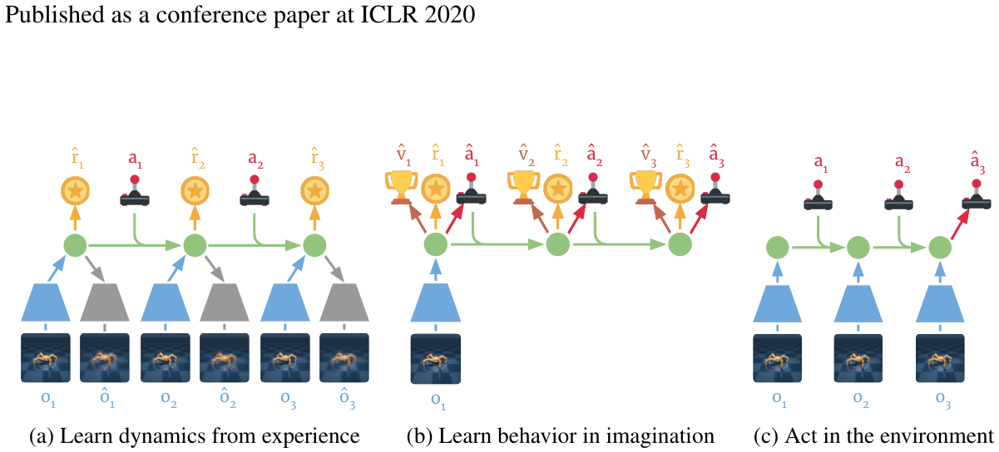
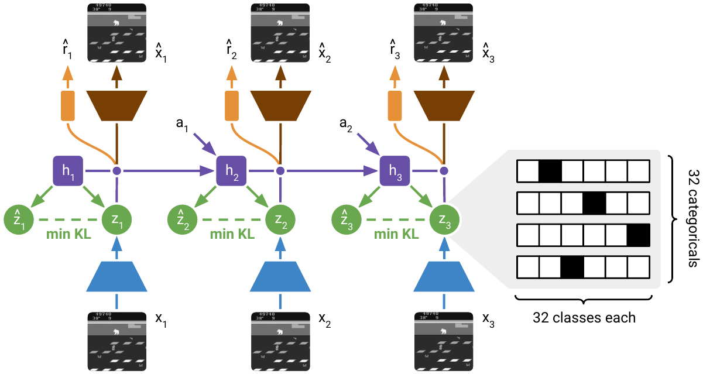
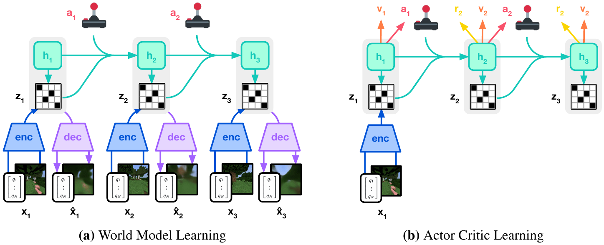

# 05 — Dreamer v1 / v2 / v3

一条线，核心都是 **RSSM 世界模型 + 在想象轨迹里训 actor-critic**。PlaNet 把 planning 换成了学出来的策略，于是不再需要每步跑 CEM。

| | 论文 | 代码 |
|---|---|---|
| Dreamer v1 | Dream to Control, ICLR 2020, arXiv:1912.01603 | `https://github.com/danijar/dreamer` (TF2) |
| DreamerV2 | Mastering Atari with Discrete World Models, ICLR 2021, arXiv:2010.02193 | `https://github.com/danijar/dreamerv2` |
| DreamerV3 | Mastering Diverse Domains through World Models, Nature 2025 / arXiv:2301.04104 | `https://github.com/danijar/dreamerv3` (JAX) |
| DreamerV3 PyTorch | — | `https://github.com/NM512/dreamerv3-torch` ← **推荐读这个** |
| DayDreamer | 真机器人, CoRL 2022 | `https://github.com/danijar/daydreamer` |

---

## 共同骨架



<small>原文 Figure 3，Hafner et al., *Dream to Control: Learning Behaviors by Latent Imagination* (arXiv:1912.01603)。版权归原作者，此处为学习笔记引用。</small>

**怎么读这张图**——三个面板对应三件完全不同的事，混起来看就乱了：

- **(a) 从经验里学动态**：底下是真实图像 `o`，蓝色梯形是 encoder，绿色圆点是隐状态。这一步**需要真实观测**，走的是 posterior
- **(b) 在想象里学行为**：注意底部**没有图像了**。全程在隐空间走 prior，黄色奖杯是预测的 reward，灰色小人是 actor，value 梯度沿虚线往回传。这是样本效率的来源
- **(c) 在环境里行动**：只有一列，encoder 吃当前观测更新状态，actor 出动作

形式化：

```
# 世界模型（RSSM）
h_t = GRU(h_{t-1}, [z_{t-1}, a_{t-1}])         # 确定性 recurrent state
z_t ~ q(z_t | h_t, CNN(o_t))                   # posterior（训练用）
ẑ_t ~ p(z_t | h_t)                             # prior（想象用）
o_t ~ p(o|h_t,z_t);  r_t ~ p(r|·);  c_t ~ p(continue|·)

# 行为学习（全部在隐空间，不解码像素）
从 replay 里每个时刻的 (h_t, z_t) 出发，用 prior + actor 想象 H 步
actor:  a ~ π(a | h, z)
critic: v(h, z) ≈ λ-return
```

**动作注入**：拼接进 GRU 输入。**想象 rollout 完全不解码图像**，所以 H=15 的想象极便宜——这是能效的关键，也是和 IRIS/DIAMOND 的根本差异（那两个的 actor 吃图像，想象时必须解码）。

---

## Dreamer v1 — 价值梯度穿过想象

**数据**：DMControl 20 个任务，64×64 像素，online replay，5e6 步预算。seed episodes = 5，collect interval C，batch B=50，sequence length L=50。

**训练**：
- 世界模型：PlaNet 的 ELBO（recon + reward + KL，free nats）
- Critic：回归 **λ-return**（λ=0.95，γ=0.99），在想象轨迹上算
- Actor：**analytic value gradient**。因为动态模型、reward head、critic 全可导，直接把 $\nabla_\phi \sum_\tau V_\lambda(s_\tau)$ 反传**穿过 H=15 步想象轨迹**（用 reparameterized 高斯动作）

这是 v1 的核心贡献：比 REINFORCE 方差小得多。原文 Figure 5 的消融显示，换成 REINFORCE 后样本效率明显下降。

**想象的并行结构**（实现时容易忽略）：从 replay 采出 B×L 个时刻，**每个时刻都作为一个想象起点**，并行展开 H 步。所以一次 update 产生 B×L×H 条想象转移（50×50×15 = 37500），这才是"在模型里采数据几乎免费"的具体含义。

---

## DreamerV2 — 离散隐变量，首个在 Atari 上匹敌人类的 MBRL



<small>原文 Figure 2，Hafner et al., *Mastering Atari with Discrete World Models* (arXiv:2010.02193)。版权归原作者，此处为学习笔记引用。</small>

**怎么读这张图**：

- 底部 `x₁ x₂ x₃` 是真实帧，蓝色梯形 encoder 往上，产出**绿色的 `z`（posterior）**
- 紫色的 `h` 是 GRU 链，往右传
- 每个时刻有**两个 z**：一个绿色的来自图像（posterior），一个也画成绿色但由 `h` 直接得出（prior）。中间标着 **`min KL`** 的虚线就是把两者拉近的那一项
- 右侧放大的那个格子图是关键：**32 行 × 32 列，每行 one-hot**。这就是 "32 个 categorical 变量 × 32 类"，拼起来 1024 维
- 上方棕色梯形是 decoder，重建出 `x̂`；`a₁ a₂` 从侧面注入 GRU

**架构改动（两条，都很重要）**：

1. **Categorical latent**：`z` 从 32 维高斯换成 **32 个 categorical × 32 类**。梯度用 **straight-through**：
   ```python
   # 别写错，这是最高频的复现 bug
   sample = one_hot(draw(logits))
   probs  = softmax(logits)
   sample = sample + probs - stop_grad(probs)
   ```
   直觉：Atari 的未来是离散多模态的（敌人出现 / 不出现），高斯 prior 表达不了。而且离散分布的 KL 有解析形式、不会出现方差塌缩。

2. **KL balancing**：把 $\mathrm{KL}[q\|p]$ 拆成两项，分别对 prior 和 posterior 停梯度，用不同权重：
   $$\beta_{\text{dyn}}\,\mathrm{KL}[\mathrm{sg}(q)\|p] + \beta_{\text{rep}}\,\mathrm{KL}[q\|\mathrm{sg}(p)]$$
   权重 0.8 / 0.2。直觉：主要让 **prior 去追 posterior**（学动态），而不是让 posterior 退化去迁就 prior（那样表征会变差）。

**数据**：Atari 55 games，**200M 帧**预算（注意不是 100k），灰度 64×64，sticky actions，action repeat 4。

**训练改动**：
- 离散动作无法 reparameterize → actor 用 **REINFORCE + baseline**；连续动作仍用 reparam
- 加 actor 熵正则
- 消融（原文 Table 2）表明贡献最大的两项就是 KL balancing 和 categorical latent

---

## DreamerV3 — 一套超参跨 150+ 任务



<small>原文 Figure 3，Hafner et al., *Mastering Diverse Domains through World Models* (arXiv:2301.04104)。版权归原作者，此处为学习笔记引用。</small>

**怎么读这张图**：

- **(a) World Model Learning**：和 V2 同构，但注意 `enc`/`dec` 成对出现在每个时刻，`z` 旁边的小方格图仍是离散表征；蓝绿色的 `h` 链在上方
- **(b) Actor Critic Learning**：**只有一个 `enc`**（最左边，从真实帧拿起点），之后全靠 `h`/`z` 往右推，上方的红点和箭头是 reward 与 value。这个对比一眼就能看出"想象不碰图像"

**数据**：DMC(proprio + pixel)、Atari 100k / 200M、Crafter、BSuite、ProcGen、Minecraft（**首个无课程、无人类数据挖到钻石**）。观测可以是像素 / 向量 / 混合；动作离散或连续统一处理。

**关键技术（都是为了"不用调参"）**：

| 技术 | 解决什么 |
|---|---|
| **symlog 变换** $\mathrm{symlog}(x)=\mathrm{sign}(x)\ln(1+\lvert x\rvert)$，用在观测重建和 critic/reward 目标上 | 不同任务 reward / 观测尺度差几个数量级 |
| **two-hot 编码 + 离散回归** 预测 reward 和 value | 回归重尾分布不稳；离散分类更稳 |
| **free bits** KL（每维下界 1 nat）+ 固定 KL 权重 | 防 posterior collapse，不用调 β |
| **return percentile 归一化**（用 return 的 5%~95% 分位距缩放 advantage） | reward 稀疏 / 稠密任务共用一组熵正则系数 |
| 所有网络 **LayerNorm + SiLU**，critic 用 EMA target + slow regularizer | 大模型稳定性 |
| 模型 12M→400M 单调涨分 | scaling 友好 |

**损失权重**（从 `dreamerv3-torch/configs.yaml` 核对过）：

```yaml
dyn_stoch: 32        # 32 个 categorical
dyn_discrete: 32     # 每个 32 类
dyn_scale: 0.5       # β_dyn，KL(sg(post) || prior)
rep_scale: 0.1       # β_rep，KL(post || sg(prior))
imag_horizon: 15
discount_lambda: 0.95
```

即世界模型损失 = (recon + reward + continue) + 0.5·KL_dyn + 0.1·KL_rep。注意 V3 的权重是 **0.5 / 0.1**，和 V2 的 0.8 / 0.2 不同。

行为：想象 H=15，λ-return，actor 用 reinforce（离散）/ 混合，加熵正则，带 percentile 归一化。**replay ratio 是主要可调旋钮**，Atari100k 用很高的 replay ratio（每条真实数据反复训很多次）。

---

## 实践建议

- 读代码：`NM512/dreamerv3-torch` 的 `models.py`（`WorldModel` / `ImagBehavior`）+ `networks.py`（`RSSM`）。官方 JAX 版性能好但抽象层多。
- 最容易出错的三处：
  1. **continue / done 预测没训好** → 想象轨迹跨越 episode 边界，value 爆炸。这是复现 Dreamer 系最高频的失败原因
  2. **想象时必须用 prior**，且第一步用 replay 的 posterior 作起点
  3. straight-through 的 `sample + probs - probs.detach()` 写法别写错
- 显存：Atari100k 配置单卡 24G 够；DMC pixel 也够。墙钟时间主要卡在 replay ratio
- **DayDreamer** = DreamerV2 直接上真机（A1 四足、XArm pick&place、UR5），核心改动是 **actor 进程与 learner 进程异步解耦**，因为真机采样慢。这是"世界模型上真机"最实用的参考实现
