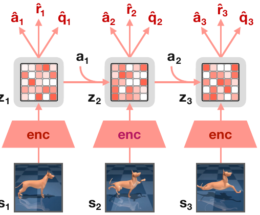

# 06 — TD-MPC / TD-MPC2（decoder-free 隐式世界模型）

- TD-MPC：Temporal Difference Learning for Model Predictive Control, ICML 2022, arXiv:2203.04955 — `https://github.com/nicklashansen/tdmpc`
- TD-MPC2：Scalable, Robust World Models for Continuous Control, ICLR 2024, arXiv:2310.16828 — `https://github.com/nicklashansen/tdmpc2`

和 Dreamer 的根本区别：**完全不重建观测**。世界模型只需要对「预测 reward 和 value」有用，不需要能画出图像。所以叫 *implicit / decoder-free* 世界模型，也叫 task-oriented latent dynamics。



<small>原文 Figure 3，Hansen et al., *TD-MPC2: Scalable, Robust World Models for Continuous Control* (arXiv:2310.16828)。版权归原作者，此处为学习笔记引用。</small>

**怎么读这张图**（信息量很大，值得逐层看）：

- 底部 `s₁ s₂ s₃` 是观测（图里是 DMC 的 dog 任务画面），每个经 **`enc`** 得到 `z₁ z₂ z₃`
- **关键点一：只有 `s₁` 的 `enc` 是实心粗体的**，`s₂ s₃` 的 enc 用来算 target（EMA encoder）。推理时只编码一次，之后全靠 `z' = d(z, a)` 往前推
- **关键点二：`z` 画成了一个带格子的方块**，格子深浅不同——这是 **SimNorm** 的可视化。latent 被分成若干组（`simnorm_dim: 8`），每组过 softmax，所以每组里只有少数格子"亮"
- **关键点三：每个 `z` 上方伸出三个箭头** `â`（policy prior）、`r̂`（reward）、`q̂`（Q 值），**没有任何箭头指回图像**。这就是"没有 decoder"的字面含义
- 横向的 `a₁ a₂` 从侧面注入 dynamics

## 架构

全部是 MLP（状态输入）或 CNN+MLP（像素输入），5 个组件：

```
encoder:      z      = h(o, e_task)
dynamics:     ẑ′     = d(z, a, e_task)
reward:       r̂      = R(z, a, e_task)
Q (ensemble): Q(z, a, e_task) × 5        # 取随机 2 个的 min
policy prior: π(z, e_task)               # MaxEnt，给 planner 提供候选动作
```

从 `tdmpc2/config.yaml` 核对：

```yaml
horizon: 3            # planning / 一致性损失的展开步数
num_q: 5              # Q 集合大小
iterations: 6         # MPPI 迭代次数
num_samples: 512      # 每次迭代采样的动作序列数
num_pi_trajs: 24      # 其中由 policy prior 直接采的条数
simnorm_dim: 8        # SimNorm 的分组大小
mpc: true
```

- **没有 decoder，没有 KL，没有随机隐变量**（确定性 latent）
- **SimNorm**：把 latent 分成若干组、每组过 softmax。等价于一种稀疏 simplex 投影，是 TD-MPC2 稳定性的关键之一（替代 LayerNorm，防止 latent 发散）
- reward 和 Q 用 **离散回归（two-hot，log 变换的 bins）**，和 DreamerV3 同思路
- 动作注入：直接拼进 dynamics MLP 输入
- 多任务时每个任务一个 **learnable task embedding** `e_task`

## 数据

- TD-MPC：DMControl + Meta-World，单任务 online
- TD-MPC2：**104 个任务跨 4 个 benchmark**（DMControl、Meta-World、ManiSkill2、MyoSuite），状态和像素输入都支持
  - 单任务 online（主要结果，DMC 1M 步内达 SOTA）
  - **多任务离线**：80 任务 / 317 任务两个大模型，用前面单任务 agent 的 replay buffer 作为离线数据集
  - 工程处理：**不同任务的 obs/action 维度不同 → 零填充到最大维度**（动作最大 `A ∈ R³⁹`），并给每个任务一个 task embedding
- 训练采样：长度 3 的短 chunk

## 训练方法

### 损失（单一联合目标，所有组件一起）

对一段长度 H=3 的轨迹，从真实 $o_t$ 编码出 $z_t$，然后**只用 dynamics 往前推**：

$$\mathcal{L} = \sum_{i=0}^{H}\lambda^i\Big[\underbrace{\|\hat z_{t+i+1} - \mathrm{sg}(h_{\text{target}}(o_{t+i+1}))\|^2}_{\text{latent consistency}} + \underbrace{\mathrm{CE}(\hat r, r)}_{\text{reward}} + \underbrace{\mathrm{CE}(Q, y_{\text{TD}})}_{\text{value}}\Big]$$

- **latent consistency 取代重建**：预测的 latent 要匹配 target encoder（EMA）编码的真实观测的 latent。这是 BYOL 风格的自监督
- **为什么不塌缩**：三件事共同作用 —— target encoder 的 EMA（避免平凡解）、reward/Q 的监督信号（latent 必须保留任务相关信息）、SimNorm（限制 latent 的表达形式）。缺任何一个都容易塌
- TD 目标用 Q ensemble 的 min + policy prior 的动作
- policy prior 单独用 MaxEnt（SAC 风格）目标训，**梯度不回传进 dynamics**

### 决策：MPPI planning + policy prior

每步做 **MPPI**（CEM 的加权版本）：

```
1. 采 512 条动作序列：一部分从高斯分布采，24 条直接由 policy prior 采
2. 在 latent 里 rollout H=3 步
3. 打分 = Σ γ^i r̂_i + γ^H Q(z_H, a_H)    ← 用 Q 作为 horizon 之外的终值
4. 按 return 的 softmax 权重更新采样分布
5. 迭代 6 次，执行第一个动作
```

两处设计值得单独记：

- **短 horizon + 学出来的终值**。PlaNet 是 H=12 纯 reward 累加，模型误差在第 12 步已经很大；TD-MPC2 只走 3 步就交给 Q，既避免误差累积又不丢长期信息。这是对 PlaNet "horizon 被模型误差设了上限"那个观察的直接回应
- **一部分候选动作直接从 policy prior 采**。纯随机采样在 39 维动作空间里几乎不可能撞上好动作；有了 prior，搜索从一个合理的起点开始

### 多任务与 scaling

- 一套超参跑 104 个任务（原文强调无需任何逐任务调参）
- 模型 1M → 317M 参数，normalized score 随 log(参数量) **近似线性增长**（原文 Figure 7）
- 原文 Figure 18/19 的消融显示 **task embedding 归一化**对多任务很重要

## 优缺点

优点：
- 单任务样本效率在连续控制上长期 SOTA，超参极少
- 无重建 → 对视觉干扰、背景杂乱鲁棒；latent 很小，planning 快
- 多任务 + 模型 scaling 友好；支持 finetune 到新任务（原文 Figure 8，低数据区间比从头训快 2 倍）

缺点：
- **不是生成式世界模型**。不能看未来、不能做视频预测、不能当模拟器给别的算法用
- 离散动作支持弱（设计针对连续控制）
- 每步 MPPI 有推理延迟（512×3×6 次 latent 前向），真机部署要注意
- latent 不可解释，调试困难——出问题时你没有"模型想象的画面"可看，这是和 Dreamer/DIAMOND 在实践体验上的最大差别

## 代码入口

```
tdmpc2/tdmpc2/
├── tdmpc2.py              # 核心：update() 是联合损失，plan() 是 MPPI
├── common/world_model.py  # 5 个组件 + SimNorm
├── common/math.py         # two-hot / symlog / soft ce
├── common/layers.py       # SimNorm 的实现
├── config.yaml            # 上面那些超参
└── train.py               # 单任务 online；另有 multitask 配置
```
