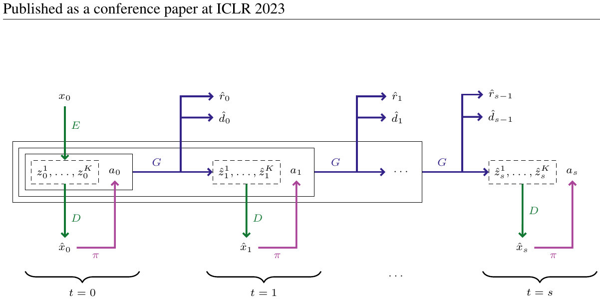
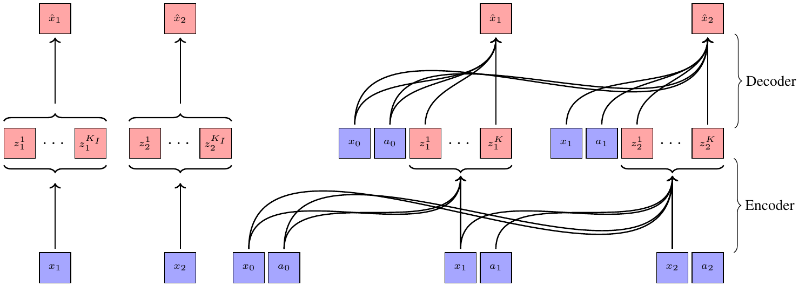

# 07 — IRIS: Transformers are Sample-Efficient World Models (ICLR 2023)

- 论文：arXiv:2209.00588（Micheli, Alonso, Fleuret）
- 代码：`https://github.com/eloialonso/iris` ← **想入门 token-based 世界模型，首选读这个**
- 续作 Δ-IRIS：Efficient World Models with Context-Aware Tokenization, ICML 2024, arXiv:2406.19320 — `https://github.com/vmicheli/delta-iris`

把世界模型变成一个 **GPT 在「图像 token + 动作 token」交错序列上做 next-token prediction** 的问题。



<small>原文 Figure 1，Micheli et al., *Transformers are Sample-Efficient World Models* (arXiv:2209.00588)。版权归原作者，此处为学习笔记引用。</small>

**怎么读这张图**（这张图把三个组件的分工画得很清楚）：

- 左下角 `x₀` 经 **E**（encoder）变成虚线框里的 token 串 `z₀¹…z₀ᴷ`，后面跟着动作 `a₀`
- **G** 就是那个 Transformer，它吃虚线框的内容，输出下一帧的 token（实线框）+ 奖励 `r̂` + 终止 `d̂`
- **D**（decoder）把 token 解回图像 `x̂`，然后**策略 π 吃的是解出来的图像**，不是 token——图中 `D → π` 这条通路是 IRIS 一个容易被忽略的设计
- 最左边只有 `t=0` 用了 **E**（真实观测入口），之后 `t=1, 2, …` 全靠 G 自回归，**E 不再出现**

## 架构

### 1) 离散自编码器（VQ-VAE 风格 tokenizer）

```
64×64×3  --conv encoder-->  4×4 feature map  --vector quantize-->  K = 16 tokens
vocabulary N = 512，embed_dim = 512
decoder: 反卷积回 64×64×3
```

从 `config/tokenizer/default.yaml` 核对：

```yaml
vocab_size: 512
embed_dim: 512
encoder.config:
  resolution: 64
  ch: 64
  ch_mult: [1, 1, 1, 1, 1]    # 5 项 -> 4 次降采样 -> 64/16 = 4 -> 4×4 = 16 tokens
  num_res_blocks: 2
  attn_resolutions: [8, 16]
```

- 每帧压成 **16 个离散 token**，这是 token 预算的核心设计
- 损失：L1/L2 重建 + **commitment loss** + **LPIPS 感知损失**（感知损失对保留小物体很重要，纯 L2 会把小物体当噪声抹掉）
- tokenizer 与 world model **分开优化**（不共享梯度），避免视觉表征跟着动态模型漂移

### 2) 自回归 Transformer（world model）

序列排布：

```
[ z_t^1, z_t^2, ..., z_t^16, a_t, z_{t+1}^1, ..., z_{t+1}^16, a_{t+1}, ... ]
  └────────── 17 tokens / block ──────────┘
```

从 `config/world_model/default.yaml`：

```yaml
tokens_per_block: 17     # 16 个图像 token + 1 个动作 token
max_blocks: 20           # 上下文覆盖 20 个时间步
attention: causal
num_layers: 10
num_heads: 4
embed_dim: 256
```

- **动作就是序列里的一个 token**，放在该帧视觉 token **之后**，表示"看完这一帧后我做了这个动作"
- 三个输出头：
  - 下一帧 token 分布（交叉熵，over 512 类）
  - **reward：只预测符号**，离散成 {−1, 0, +1} 三类。代码里是 `labels_rewards = (rewards.sign() + 1)`（`world_model.py:120`），交叉熵。注意**不是 two-hot 回归**，这是和 DreamerV3 的一处明显差异
  - episode termination（二分类）

> reward 取符号是 Atari 的常规做法（reward clipping），把不同游戏的奖励尺度一刀切平；代价是模型分不清"吃一个豆子"和"过一关"。想象时是**从这个三类分布里采样**（`world_model_env.py:75`），不是取 argmax。

### 3) Actor-Critic

- 输入是 tokenizer **decode 出来的图像**（而非 token 或 latent）→ 小 CNN + LSTM → π 和 V
- 好处：策略在想象里和在真环境里看到的输入形式完全一致，迁移没有 gap
- 代价：想象时必须解码图像，比 Dreamer 贵得多

## 数据

- **Atari 100k**，26 个游戏，预算 100k 真实交互步（≈ 2 小时人类游戏）
- 观测 64×64 RGB，离散动作
- 采集：**online 交替**，600 个 epoch，每个 epoch 收集约 200 步
- replay buffer 存完整 episode，训练时采 L=20 的片段

## 训练方法

从 `config/trainer.yaml` 核对的实际时序：

```
epochs: 600
for epoch in 1..600:
    1. collect: 用当前 actor 在真环境采 ~200 步（带 ε 探索）
    2. train tokenizer      (start_after_epochs: 5,  stop_after_epochs: 500)
    3. train world model    (start_after_epochs: 25)
    4. train actor-critic   (start_after_epochs: 50) 【完全在想象里】
         - 从 buffer 随机取真实观测作为起点，burn_in = 20
         - 想象 H = 20 步（= world_model.max_blocks）
         - 每步生成 16 个 token -> decode 成图像 -> actor 出动作
         - REINFORCE + λ-return + 熵正则
```

注意那三个 `start_after_epochs`：**tokenizer 先单独训 20 个 epoch，世界模型再训 25 个，最后才开始训策略**。这个错位很重要——在 tokenizer 还没稳定时训世界模型，token 的语义一直在变，等于目标在动。

actor-critic 的损失（`models/actor_critic.py`）：

```python
lambda_returns = compute_lambda_returns(rewards, values, ends, gamma, lambda_)
loss_actions = -(log_probs * (lambda_returns - values.detach())).mean()   # REINFORCE
loss_values  = F.mse_loss(values, lambda_returns)
loss_entropy = -entropy_weight * d.entropy().mean()
```

想象起点来自真实 buffer + H 只有 20 步 → 防止长程漂移（和 SimPLe 同思路）。

## 结果

- Atari 100k 平均 human-normalized score **1.046**，26 个游戏中 10 个超人类；在"无 lookahead search"的方法里是当时 SOTA
- 最大优势在需要长程记忆和精确视觉细节的游戏
- 原文 Figure 3 展示了 Pong 上**像素级完美**的长程预测，Figure 4 展示 reward/done 预测

## Δ-IRIS 的改进



<small>原文 Figure 1，Micheli et al., *Efficient World Models with Context-Aware Tokenization* (arXiv:2406.19320)。版权归原作者，此处为学习笔记引用。</small>

**怎么读这张图**：左边是 IRIS 的自编码器——每帧独立编码，encoder 只看当前帧。右边是 Δ-IRIS——**encoder/decoder 都额外接收前一帧和动作**（那些从左下方横过来的长弧线），所以只需要编码「给定 `o_t` 和 `a_t` 之后仍无法推出的那部分」。

问题：IRIS 每帧 16 token，序列长度随 horizon 线性膨胀，复杂环境需要更多 token，算力爆炸。

做法：
- tokenizer 不编码整帧，而是编码**相对上一帧的 stochastic delta**
- Transformer 同时接收**连续 token**（概括当前世界状态）和离散 delta token

实际配置（`config/params/atari.yaml`，Atari / Crafter 一致）：

```yaml
tokenizer:
  num_tokens: 4          # 每帧仅 4 个 delta token（IRIS 是 16）
  codebook_size: 1024    # 词表比 IRIS 的 512 大一倍
world_model:
  tokens_per_block: 1 + 1 + 4    # = 6：1 个连续状态 token + 1 个动作 token + 4 个 delta token
```

结果：Crafter 上大幅超越，Atari 100k 上更快更好。

## 代码入口

```
iris/src/
├── trainer.py                   # 主循环（collect / tokenizer / wm / actor-critic）
├── models/tokenizer/            # VQ-VAE
├── models/world_model.py        # GPT + 三个头；reward 的 sign 离散化在 120 行
├── models/actor_critic.py       # REINFORCE + λ-return
├── models/kv_caching.py         # 自回归生成的 KV cache（想象速度的关键）
├── envs/world_model_env.py      # 把 WM 包成 gym.Env ← 最值得读的文件
└── play.py                      # 人工在学到的世界模型里玩
```

`world_model_env.py` 把世界模型包装成标准 `gym.Env`（`step(action)` 返回想象出的 obs/reward/done）。这个抽象非常值得照搬——它让"换世界模型"和"换 RL 算法"彻底解耦。
