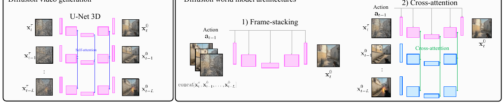

# 08 — DIAMOND: Diffusion for World Modeling (NeurIPS 2024 Spotlight)

- 论文：*Diffusion for World Modeling: Visual Details Matter in Atari*, arXiv:2405.12399
- 代码：`https://github.com/eloialonso/diamond`（主页 https://diamond-wm.github.io）
- 作者和 IRIS 同一拨人，可以看作"把 token 换成 diffusion"的对照实验

核心论点：**离散 token 会丢视觉细节，而视觉细节直接决定 RL 性能**。所以干脆在**像素空间**用扩散模型做世界模型。



<small>原文 Figure 9，Alonso et al., *Diffusion for World Modeling: Visual Details Matter in Atari* (arXiv:2405.12399)。版权归原作者，此处为学习笔记引用。</small>

**怎么读这张图**（三栏对照，右边两个是本文的候选方案）：

- **最左「Diffusion video generation」**：标准视频扩散的做法，U-Net **3D**，一次性对一整块帧去噪。问题是没法逐帧接受新动作
- **中间「1) Frame-stacking」**：把过去 L 帧沿**通道维拼接**，和带噪的当前帧一起喂进 U-Net **2D**。动作从上方注入。**这是正文采用的方案**——轻量，不需要额外参数
- **右边「2) Cross-attention」**：U-Net 3D，只给当前噪声帧作直接输入，历史帧经另一个编码器后**交叉注意**进来

论文实测 frame-stacking 就够用且更省，所以正文用它。知道这个对照很有用：很多人以为扩散世界模型必须用 cross-attention，其实通道拼接在短历史（L=4）下反而更好。

## 架构

### 世界模型 = 条件 EDM 扩散

用 Karras et al. 的 **EDM** 框架（不是 DDPM），条件是过去 L 帧和 L 个动作：

$$x_{t+1} \sim p_\theta(\cdot \mid x_{t-L+1:t},\, a_{t-L+1:t})$$

从 `config/agent/default.yaml` 和 `config/trainer.yaml` 核对：

```yaml
num_steps_conditioning: 4      # 条件帧数 L = 4
num_steps_denoising: 3         # 推理时只去噪 3 步
world_model_env.horizon: 15    # 想象 horizon
```

- 去噪网络：**U-Net 2D**（conv + self-attention），标准 ADM 风格
- 条件注入：
  - 过去 L=4 帧沿**通道维拼接**到带噪输入上
  - 动作 one-hot → embedding → **与噪声水平 embedding 相加**，再通过 adaptive group norm 调制每个残差块
- 另有独立的小网络预测 **reward 和 episode end**（CNN+LSTM，不是扩散）
- **没有隐空间、没有 tokenizer、没有 KL**。Atari 版直接在像素上扩散；CS:GO 版因分辨率高才加了 upsampler

### 为什么选 EDM 而不是 DDPM

EDM 的预条件参数化（代码 `models/diffusion/denoiser.py`）：

```python
c_in   = 1 / sqrt(sigma**2 + sigma_data**2)
c_skip = sigma_data**2 / (sigma**2 + sigma_data**2)
c_out  = sigma * sigma_data / sqrt(sigma**2 + sigma_data**2)
```

这组系数让网络在**任意噪声水平下的输入/输出都保持单位方差**，于是**极少步采样依然稳定**。这不是审美选择，而是可行性前提——如果每帧要 50 步去噪，想象 15 步就是 750 次网络前向，RL 循环直接跑不动。

原文 Figure 3 直接对比了 DDPM 和 EDM 骨干的想象轨迹：DDPM 在少步设定下明显漂移。Figure 4 做了 n 的消融，结论是 **n=3**（n=1 有明显伪影，再大收益很小）。

## 数据

两套实验：

### (a) Atari 100k（RL）
- 26 个游戏，100k 真实交互步，64×64 RGB，离散动作
- online 交替采集（同 IRIS 的循环结构）
- 训练片段长度 = `horizon + num_steps_conditioning` = 15 + 4 = 19

### (b) CS:GO 神经游戏引擎（纯离线）
- **87~95 小时人类 Counter-Strike: Global Offensive 对局录像**（Dust II 地图，来自 Pearce & Zhu 的数据集）
- 动作 = 键盘按键 + 鼠标位移（连续）
- **完全离线，不训策略**，只为证明世界模型本身可以当可交互游戏引擎
- 分辨率 280×150，另训一个 **upsampler** 做高清输出，实时 10 FPS（RTX 4090）

原文附录 M 还做了高速公路驾驶数据的实验（Figure 11），固定动作能看出明显的转向差异——这就是 action-following 的定性验证。

## 训练方法

### 世界模型：denoising score matching

```
采一段 (x_{t-3..t+1}, a_{t-3..t})
给 x_{t+1} 加噪声 σ ~ lognormal(P_mean, P_std)
网络预测去噪结果，按 EDM 的加权做 L2
```

**两个关键稳定性技巧**：

1. **历史帧加噪增强**：训练时给作为条件的过去帧也加少量噪声。因为推理时模型看到的历史帧是**它自己生成的、带瑕疵的**，而训练时看到的是干净真实帧——这个错配（exposure bias）就是自回归漂移的根源。让它在训练时就习惯"脏历史"，漂移大幅缓解。原文 Figure 8 用"预测轨迹与参考轨迹的平均像素漂移"量化了这一点。
2. **少步采样**：推理用 Euler 法 **n=3** 步。

### 行为学习

- 和 IRIS 同构：**完全在想象里**训 actor-critic（REINFORCE + λ-return + 熵正则）
- 想象 horizon H=15，起点从真实 buffer 取
- actor 吃想象出的像素帧（CNN + LSTM）

```
for epoch:
    collect 真实数据 → 训 diffusion WM → 训 reward/end 模型 → 想象内训 actor-critic
```

## 结果

- Atari 100k 平均 human-normalized score **1.46**，当时"纯在世界模型内训练"的最佳成绩（超过 IRIS 的 1.046、DreamerV3）
- 原文 Figure 5 把 IRIS 和 DIAMOND 的连续想象帧并排，白框标出 IRIS 的不一致处——收益主要来自小而关键的视觉元素（子弹、远处敌人）得到保留，正是 VQ tokenizer 容易丢的东西
- CS:GO 演示：纯离线人类录像 → 可用键鼠实时交互的神经游戏引擎

## 可以直接玩

```bash
python src/play.py --pretrained          # 在学到的 Atari 世界模型里手玩
python src/play.py                       # CSGO 世界模型（需下对应权重）
```

## 代码入口

```
diamond/src/
├── main.py / trainer.py                   # 主循环
├── models/diffusion/denoiser.py           # EDM 预条件 + 条件注入
├── models/diffusion/diffusion_sampler.py  # n 步 Euler 采样
├── models/rew_end_model.py                # reward / termination
├── envs/world_model_env.py                # WM 包成 Env（同 IRIS 的抽象）
├── agent.py                               # actor-critic
└── play.py                                # 交互式 rollout
```

## 和 IRIS 对比速查

| | IRIS | DIAMOND |
|---|---|---|
| 表征 | VQ 离散 token（16/帧） | 无，直接像素 |
| 动态 | GPT next-token | EDM U-Net 扩散 |
| 动作注入 | 序列里一个 token | 通道拼接 + adaLN |
| 随机性来源 | token 采样 | 扩散噪声 |
| 条件历史长度 | 20 步（attention 上下文） | 4 帧（通道拼接） |
| 漂移对策 | 真实起点 + 短 H | 历史帧加噪 + 真实起点 |
| 想象 horizon | 20 | 15 |
| 单步代价 | 16 次自回归前向 | 3 次 U-Net 前向 |
| Atari100k | 1.046 | 1.46 |

注意条件历史长度那一行：IRIS 靠 attention 能看 20 步历史，DIAMOND 只看 4 帧。**DIAMOND 用视觉保真度换掉了长程记忆**——这是它在需要长期记忆的游戏上并不占优的原因。
