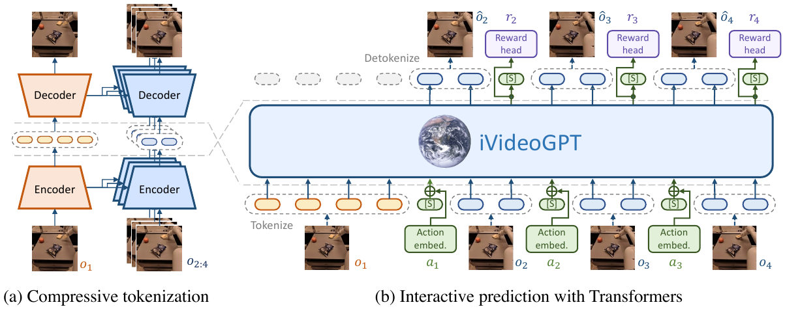

# 09 — iVideoGPT: Interactive VideoGPTs are Scalable World Models (NeurIPS 2024)

- 论文：arXiv:2405.15223（清华 THUML，Jialong Wu et al.）
- 代码 + 预训练权重：`https://github.com/thuml/iVideoGPT`
- 同组相关：`thuml/Vid2World`（把视频扩散模型改造成交互式世界模型）、`thuml/RLVR-World`（用 RL 训世界模型）

定位：**把"大规模预训练视频生成"和"可交互的 action-conditioned 世界模型"接起来**。前者数据多但不可控，后者可控但只能在单个小环境上从零训。



<small>原文 Figure 3，Wu et al., *iVideoGPT: Interactive VideoGPTs are Scalable World Models* (arXiv:2405.15223)。版权归原作者，此处为学习笔记引用。</small>

**怎么读这张图**（两个面板是两件事）：

- **(a) Compressive tokenization**（左）：上下两路 Encoder/Decoder 是**不同的**。下面那一路处理 **context 帧**（`o₁`），稠密编码；上面那一路处理**后续的 dynamics 帧**（`o₂:₄`），它的 encoder/decoder 用虚线连回 context 的特征——那就是 **cross-attention**。因为能看到 context，后续帧只需编码"变化量"，token 数大幅减少
- **(b) Interactive prediction with Transformers**（右）：中间蓝色大框是 GPT 主体。注意底部那一排橙色小块 **`Action embed.`**，它们是**加到视觉 token 上**的（图中是竖直向上的短箭头汇入 token 序列），而**不是**作为独立 token 插在序列里。右上角还有 **Reward head**
- 两个面板中间的 `Tokenize` / `Detokenize` 标注说明了数据流向：先 (a) 压成 token，再进 (b) 自回归预测，最后解回图像

## 数据

这是全篇最关键的差异点：**大规模离线预训练 + 下游微调**，而非 online 从零训。

**预训练**（混合数据集，百万级轨迹）：
- **Open X-Embodiment (OXE)** 机器人操作数据子集（多个真机数据集，带动作）
- **Something-Something v2** 人类操作视频（**无动作标注**，只做无动作的视频预测预训练）
- 共约 150 万条轨迹

**下游微调 / 评测**：
- **BAIR robot pushing**（action-conditioned & action-free 视频预测）
- **RoboNet**（跨机器人泛化）
- **VP2 benchmark**（视觉 MPC）
- **Meta-World / RoboDesk**（visual MBRL）

动作形式：连续机械臂动作（末端位姿增量 + gripper），通过线性层投到 token embedding 维度。

## 架构

### 1) Compressive Tokenizer（核心创新）

问题：VQGAN 把每帧压成 K 个 token，长视频 token 数爆炸。
观察：**视频里相邻帧高度冗余**，后续帧只需编码相对 context 的变化。

```
context 帧 (前 T₀ 帧):  双层 VQGAN 稠密编码  →  每帧 N = 16×16 = 256 tokens
dynamics 帧 (之后):     conditional encoder（cross-attention 看 context 多尺度特征）
                        →  每帧仅 n = 4×4 = 16 tokens
```

- token 数降一个数量级（论文说在渐近意义上是 **16 倍** 缩减）→ 可以在单卡上做 16 帧以上的交互式 rollout
- 思路和 Δ-IRIS 的 delta tokenization 一致，但做到了预训练规模

tokenizer 损失（原文式 2）：

$$\mathcal{L}_{\text{tokenizer}} = \sum_{t=1}^{T_0}\mathcal{L}_{\text{VQGAN}}\big(o_t; E_c, D_c\big) + \sum_{t=T_0+1}^{T}\mathcal{L}_{\text{VQGAN}}\big(o_t; E_p(\cdot|o_{1:T_0}), D_p(\cdot|o_{1:T_0})\big)$$

其中 $\mathcal{L}_{\text{VQGAN}}$ = L1 重建 + commitment + **LPIPS 感知** + **GAN 判别器**。GAN 项对高频细节很关键。

### 2) Autoregressive Transformer

```
序列 = [ ctx 帧 tokens, [S], ..., dyn 帧 tokens, [S], ... ]
长度 L = (N+1)·T₀ + (n+1)·(T − T₀) − 1
```

- `[S]` 是**特殊 slot token**，用来划分帧边界、并为动作这类低维模态提供插入位
- backbone：GPT-2 的尺寸，但用 **LLaMA 架构**（pre-normalization + RMSNorm + SwiGLU + RoPE）
- 两个尺寸：**138M**（主要实验）和 **436M**（scaling 分析）
- **动作注入**：动作经线性层映射后**加到该时刻第一个视觉 token 的 embedding 上**（additive），而非当作独立 token
- reward 预测：加一个线性头（下游 MBRL 用）

**为什么用 additive 而不是独立 token**（这是全篇最值得记的设计取舍）：这样一来**有动作和没动作可以共用同一个架构**——没有动作时这一项置零即可，**序列长度完全不变**。于是无标注视频（SSv2）和带标注机器人数据（OXE）能混在一起预训练。

对比 IRIS 的"动作当一个 token"：那个方案更优雅，但要求每一帧都必须有动作标注。**这是一次有意识的优雅性让渡**，换来的是能吃无标注视频。

## 训练方法

### 阶段一：预训练（动作可选）
1. 先训 compressive tokenizer（VQ + L1 + LPIPS + GAN）
2. 冻结 tokenizer，训 Transformer 做 next-token 交叉熵；大部分数据无动作

### 阶段二：下游微调（加动作、加 reward）
- 在目标域数据上微调 Transformer（tokenizer 通常也微调）
- 打开动作条件分支 + reward 头
- 论文强调：**预训练带来的泛化让下游只需很少数据**

### 阶段三：用作世界模型做 MBRL
- 把 iVideoGPT 包成环境
- 论文的 MBRL 实验是**把 DreamerV3 的世界模型换成 iVideoGPT**，保留其 actor-critic（原文 Figure 6）
- VP2 上则接 visual MPC / CEM
- Meta-World 上在少量真实交互下超过无模型基线

### 一处值得注意的消融

原文 Figure 10 做了 **context-dynamics decoupling**：把后续帧到 context 的 cross-attention 去掉之后，模型对 context 的利用显著下降。这验证了"稀疏 token 之所以够用，是因为信息从 context 那边流过来了"，而不是模型真的只需要 16 个 token。

## 评价

优点：
- 真正做到了**跨任务可迁移的通用 action-conditioned 世界模型**，有现成预训练权重
- compressive tokenization 的 token 预算设计很实用，可以直接搬
- 支持 action-free 与 action-conditioned 混合训练，解决了"带动作标注的数据太少"这个根本矛盾

缺点 / 注意：
- 自回归 token 生成的视觉保真度不如扩散（尤其纹理细节）
- 机器人操作域（桌面、固定视角）为主，对大场景 / 驾驶泛化未验证
- 预训练很贵；实际用法应该是**拿它的权重微调**，而不是复现预训练

## 代码入口

```
iVideoGPT/
├── train_tokenizer.py       # compressive tokenizer（VQ + LPIPS + GAN）
├── train_gpt.py             # Transformer 预训练 / 微调
├── ivideogpt/
│   ├── vq_model/            # 双层 VQGAN + conditional encoder/decoder
│   └── transformer/         # llama-style，含 additive action conditioning
├── mbrl/                    # 下游 MBRL（Meta-World，DreamerV3 换骨干）
└── scripts/                 # 各 benchmark 的评测脚本
```

HuggingFace 上有 `thuml/ivideogpt-oxe-64-act-free` 等若干权重，先跑 inference demo 比读代码快。
