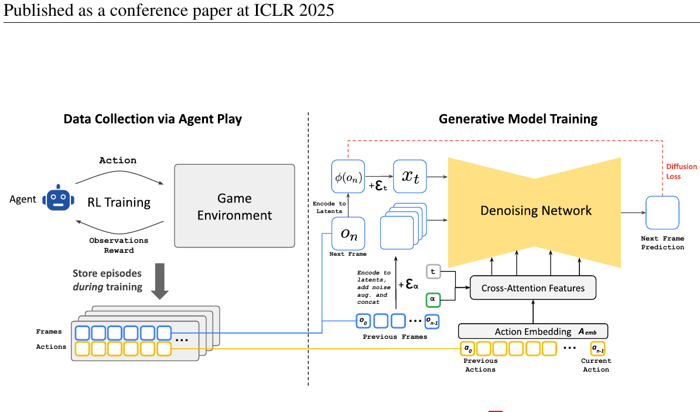
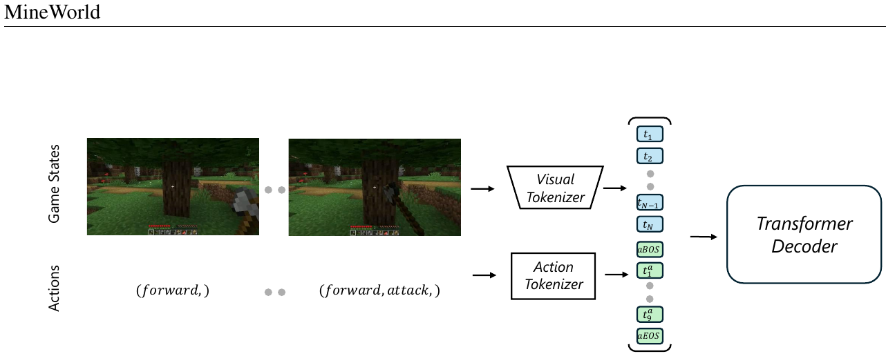

# 10 — 实时可玩的游戏世界模型（Oasis / MineWorld / GameNGen / Genie）

这一类不训策略，目标是 **「神经游戏引擎」**：给初始画面 + 实时键鼠输入，生成下一帧，可交互可玩。动作条件的质量（action following）是核心指标。

| 方法 | 机构 | 代码 | 说明 |
|---|---|---|---|
| GameNGen | Google | ❌ 无代码 | DOOM，SD1.4 改造，20 FPS |
| Genie / Genie 2 / 3 | DeepMind | ❌ 无代码 | latent action 无监督学习 |
| **Oasis 500M** | Decart + Etched | ✅ 仅推理 `https://github.com/etched-ai/open-oasis` | Minecraft，DiT |
| **MineWorld** | Microsoft | ✅ **训练+推理全开** `https://github.com/microsoft/mineworld` | Minecraft，自回归 Transformer |
| Matrix-Game / Matrix-Game 2 | 昆仑万维 | ✅ | Minecraft / 通用，蒸馏到实时 |
| GameFactory | — | ✅ 含开源 Minecraft 键鼠数据 | 动作控制可迁移到开放域 |

---

## 10.1 GameNGen（Diffusion Models Are Real-Time Game Engines, 2024, arXiv:2408.14837）

**无官方代码**，但方法影响很大，必须知道。



<small>原文 Figure 3，Valevski et al., *Diffusion Models Are Real-Time Game Engines* (arXiv:2408.14837)。版权归原作者，此处为学习笔记引用。</small>

**怎么读这张图**（左右两块是两个独立阶段，中间虚线分隔）：

- **左「Data Collection via Agent Play」**：先用 RL 训一个 agent 去玩 DOOM，把它整个训练过程的轨迹（`Frames`/`Actions`）全部录下来成为数据集。注意是**用 agent 而非人类采集**——这样覆盖面可控、数据可无限生成，而且能涵盖从菜鸟到高手的各种水平
- **右「Generative Model Training」**：
  - 左下的 `Previous Frames` 经 encoder 进 latent，**注意那个 `+ε` 标记**——这就是 noise augmentation，给历史帧**主动加噪**
  - `Previous Actions` 经 **`Action Embedding A_emb`** 注入
  - 中间黄色的 `Denoising Network` 就是改造后的 SD U-Net，右侧输出 `Next Frame Prediction`
  - 顶部红色虚线标着 `Diffusion Loss`

- **数据**：先训 RL agent 玩 DOOM，录下全部轨迹（帧 + 动作 + 状态）
- **架构**：Stable Diffusion v1.4 改造
  - 去掉文本条件，换成「过去 N 帧的 latent（通道拼接）+ 过去 N 个动作（embedding，加到 timestep embedding）」
  - 自回归：每步生成一帧 latent，VAE 解码
- **训练**：
  - 关键技巧 **noise augmentation**：训练时给作为条件的历史 latent 加随机强度噪声，**并把噪声强度本身也作为条件输入**。消融显示去掉后几十帧就崩
  - 第二阶段微调 VAE decoder 修复 HUD / 数字等细节
  - 推理 **4 步 DDIM**（蒸馏后），单 TPU 20 FPS
- 人类评测者在 1.6~3.2 秒片段上难以区分真实 DOOM 和生成结果

---

## 10.2 Oasis（Decart & Etched, 2024）

- **数据**：**OpenAI VPT 的 Minecraft contractor 数据集**（人类游玩录像，带键鼠动作标注，数千小时）。这是公开可得的、带动作标注的最大游戏数据集，Oasis / MineWorld / Dreamer 4 都用它
- **架构**：
  - 空间 VAE（逐帧压 latent，**不做时间压缩**）
  - **DiT**（diffusion transformer），时空注意力
  - 动作条件：每帧的键盘 one-hot + 鼠标连续位移 → embedding → **adaLN 调制**
- **训练**：**Diffusion Forcing** —— 序列中每一帧独立采样噪声水平。这样模型天然学会"在干净的历史 + 纯噪声的当前帧"这个自回归推理模式，无需额外的 noise augmentation 技巧
- 开源部分：**只有 500M 的下采样版权重 + 推理脚本**，无训练代码、无数据管线

```bash
python generate.py          # 给定初始帧 + 动作序列，自回归生成
# 权重在 HuggingFace: Etched/oasis-500m (oasis500m.pt + vit-l-20.pt)
```

### Diffusion Forcing 为什么比 noise augmentation 干净

```
标准视频扩散：  整段共享一个噪声水平 σ
                [σ][σ][σ][σ]      → 一次生成一整段，无法逐帧接受新动作

noise aug：     历史干净 + 人为加一点噪声（补丁式）
                [ε][ε][ε][纯噪声]  → 有效，但噪声强度是额外引入的超参

Diffusion Forcing：每帧独立采样噪声水平（写进训练目标）
                [干净][干净][半噪][纯噪声]
                 └── 历史 ──┘  └─ 待生成 ─┘
                ↑ 这正好就是自回归推理时的样子
```

前者是在训练后期打补丁，后者让**训练目标本身就等价于推理模式**。Dreamer 4 的 shortcut forcing 是在此之上再加「少步生成」。

---

## 10.3 MineWorld（Microsoft, 2025, arXiv:2504.08388）

**这一类里唯一训练代码完全开源的**，想自己训游戏世界模型应该从这里开始。



<small>原文 Figure 1，Guo et al., *MineWorld: a Real-Time and Open-Source Interactive World Model on Minecraft* (arXiv:2504.08388)。版权归原作者，此处为学习笔记引用。</small>

**怎么读这张图**：左边两行分别是 **Game States**（游戏画面）和 **Actions**（`(forward,)`、`(forward, attack,)` 这种动作组合）。两者各过一个 tokenizer——**Visual Tokenizer** 和 **Action Tokenizer**——变成离散 token，然后**交错拼成一条序列**（图中间那一列小方块，颜色区分视觉/动作），最后喂进 **Transformer Decoder** 做 next-token 预测。注意动作 token 放在该帧视觉 token **之前**（和 IRIS 相反），表示"要执行这个动作，于是产生接下来的画面"。

- **数据**：VPT contractor 数据 + 自采 MineRL 数据，筛选后数千小时。动作空间离散化成一个紧凑的 token 词表（移动 / 视角 / 攻击 / 使用等组合）
- **架构**：**纯自回归，不用扩散**
  ```
  VQ 视觉 tokenizer（每帧 N 个离散 token）
  序列 = [ a_1, z_1 tokens, a_2, z_2 tokens, ... ]
  backbone = LLaMA 风格 causal Transformer（300M / 700M / 1.2B 三档）
  ```
- **训练**：标准 next-token 交叉熵。tokenizer 单独训（VQGAN + 感知 + GAN 损失）
- **推理加速：Diagonal Decoding (DiagD)** —— 利用"同一帧内空间相邻 token 相关、跨帧时间上可并行"的结构，沿对角线方向并行解码多个 token，达到 **4~7 FPS** 实时交互，比朴素自回归快 3 倍以上
- **评测**：除了 FVD/PSNR，还用一个 **IDM（inverse dynamics model）从生成视频反推动作**，比对是否与给定动作一致 —— 这是衡量 action-following 最靠谱的自动指标，值得借用

```
mineworld/
├── train_tokenizer.py / train_transformer.py
├── inference.py            # 批量生成
├── interactive.py          # 实时手玩（gradio）
└── evaluate/               # FVD + IDM action-following 指标
```

---

## 10.4 Genie 系列（DeepMind, 2024-2025）

**无代码**，论文 PDF 也没有文字层（无法提取原图），但它提出了最重要的一个概念：**latent action**。


<small>依据 Bruce et al., *Genie: Generative Interactive Environments* (arXiv:2402.15391) 的描述绘制，非原文插图。</small>

- **数据**：**完全无动作标注**的互联网 2D 平台游戏视频（20 万小时级别）
- **架构三件套**：
  1. **video tokenizer**（ST-ViViT，时空 token）
  2. **latent action model (LAM)**：一个 VQ-VAE，输入 $(o_t, o_{t+1})$，输出一个极小词表（|A|=8）的离散 latent action，并要求用 $o_t$ + 该 latent action 能重建 $o_{t+1}$
  3. **dynamics model**：MaskGIT 风格 Transformer，条件于历史 token + latent action
- **训练**：LAM 和 dynamics 联合训；推理时**丢掉 LAM 的 encoder**，用户直接指定 latent action 的离散 id 来控制
- **为什么词表必须极小**：|A|=8 是强约束。模型被迫把"所有能发生的变化"压缩成几个最主要的控制维度，结果学出来的东西真的对应"上/下/左/右/跳"这类语义。词表一大就会退化成"把下一帧的内容也编码进去"，失去可控性
- **意义**：解开了"带动作标注数据太少"这个死结。任何后续想用互联网视频训 action-conditioned 世界模型的工作（包括机器人领域的 LAPA、Genie-style VLA）都在用这个思路

开源近似实现可参考 `1x-technologies/1xgpt`（1X 的 world model challenge，给了 latent action + 数据）。

---

## 这一类的共同设计要点

1. **不能做时间维压缩**。latent 必须逐帧对应原始帧，否则无法每帧接受一个新动作。而市面上绝大多数现成的视频 VAE 都带 4× 或 8× 时间压缩——拿来就用会发现模型根本不响应动作。Oasis 专门用了只做空间压缩的 VAE
2. **自回归漂移是头号敌人**，三种主流解法：
   - noise augmentation（GameNGen）
   - Diffusion Forcing / 独立噪声水平（Oasis、Dreamer 4）
   - 自回归 token + teacher forcing（MineWorld，天然无 exposure bias 但仍有累积误差）
3. **实时性**：少步扩散蒸馏（4 步）、对角并行解码、或干脆用小模型。交互体验的门槛大约是 10 FPS
4. **数据瓶颈在动作标注**：VPT contractor 数据几乎是公开的唯一大规模选择；否则就走 Genie 的 latent action 路线，或用 IDM 给无标注视频打伪动作标签（VPT 本身就是这么做出来的）
5. **评测必须测可控性**，不能只报 FVD。FVD 高只说明画得像，不说明听指令。MineWorld 的 IDM 反推法是目前最实用的自动指标
