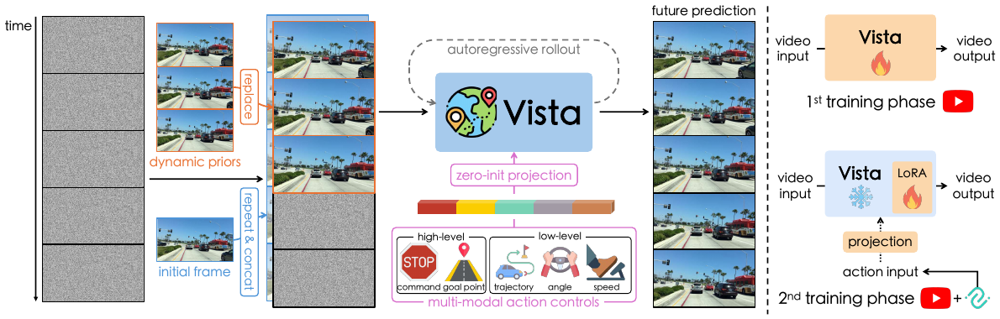

# 11 — 驾驶世界模型（Vista / GAIA-1 / DriveDreamer / 占据栅格系）

自动驾驶是 action-conditioned 世界模型落地最积极的方向，因为「给定一条候选轨迹，预测未来会发生什么」正好是规划需要的东西。

| 方法 | 代码 | 动作形式 | 输出空间 |
|---|---|---|---|
| **Vista** (NeurIPS 2024) | ✅ `https://github.com/OpenDriveLab/Vista` | 轨迹 / 转角+速度 / 指令 / 目标点 | 前视视频 |
| GAIA-1 (Wayve) | ❌ | 转角 + 速度 + 文本 | 视频 |
| DriveDreamer / -2 | ✅ `https://github.com/f1yfisher/DriveDreamer` | 轨迹 + HDMap + 3D box | 多视角视频 |
| DrivingDiffusion / MagicDrive | ✅ | BEV layout + 相机参数 | 多视角视频 |
| OccWorld / OccSora | ✅ `https://github.com/wzzheng/OccWorld` | ego 轨迹 | **3D 占据栅格** |
| GenAD / OpenDV | ✅ `https://github.com/OpenDriveLab/DriveAGI` | 文本 / 指令 | 视频（含 1700h 数据集） |
| ReSim / WorldEngine | ✅ OpenDriveLab | 含非专家动作 | 视频 / 3DGS 仿真 |

---

## 11.1 Vista（重点，开源最完整）

论文：*Vista: A Generalizable Driving World Model with High Fidelity and Versatile Controllability*, arXiv:2405.17398



<small>原文 Figure 3，Gao et al., *Vista: A Generalizable Driving World Model* (arXiv:2405.17398)。版权归原作者，此处为学习笔记引用。</small>

**怎么读这张图**（左右两块是两件独立的事，很容易看混）：

- **左半「Vista pipeline」**：最左一列是时间轴上的输入。注意有**三种**条件帧可选——`initial frame`（只给一帧）、`dynamic priors`（给前几帧，让模型知道当前的运动状态）。中间 `autoregressive rollout` 那个环形箭头表示长程续推；下方一排彩色小块是**多模态动作控制**（command / trajectory / angle / speed / goal point），经 `projection` 注入。右侧 `future prediction` 是输出
- **右半「Training procedure」**：两行分别是两个训练阶段。第一行 `video input → Vista → video output`，骨干是**可训的**；第二行骨干旁边挂了个 **LoRA** 标记、并画了**雪花（冻结）**图标，只有 `action input → projection` 这条分支在训。这一眼就说明了「大数据学动态、小数据学控制」是怎么落到实现上的

### 数据

- **OpenDV-YouTube**：1700+ 小时 YouTube 驾驶视频（比 nuScenes 大约 300 倍），**无动作标注**，用于学高保真动态与泛化
- **nuPlan**：带 ego 轨迹 / 速度 / 转角的真实驾驶数据，用于学动作条件
- 评测还用 nuScenes、Waymo、CODA 等做零样本泛化
- 分辨率 576×1024（比大多数世界模型高得多），10 Hz，25 帧片段

### 架构

基于 **Stable Video Diffusion (SVD)**，latent video diffusion：

```
图像 VAE → latent → 3D U-Net（空间注意力 + 时间注意力/卷积）→ 去噪
条件：
  - 参考帧（CLIP embedding + latent 通道拼接）
  - 动作：各形式各自经 MLP / Fourier embedding → 统一维度 → 注入
```

**动作支持 5 种粒度，统一处理**：

| 粒度 | 形式 | 谁会给 |
|---|---|---|
| 高层指令 | 左 / 直 / 右 | 导航模块 |
| 目标点 | 2D 坐标 | 导航 / 人工 |
| 轨迹 | 未来若干 waypoint | 规划器 |
| 转向角 | 标量序列 | 控制器 |
| 速度 | 标量序列 | 控制器 |

训练时**随机丢弃 / 选择某一种动作模态**（classifier-free 风格的条件 dropout），所以推理时可以只给其中任意一种。规划器有轨迹就给轨迹，只有意图就给指令。**这个设计很值得借鉴**——否则你的世界模型只能对接一种规划器。

### 训练方法：两阶段

**阶段一：高保真未来预测（只用视频，无动作）**

在 OpenDV-YouTube 上微调 SVD。两个"动态增强"损失（本文方法贡献）：

- **Dynamics Enhancement Loss**（原文式 2–3）：先算相邻帧预测的差分不一致度，得到一个**逐区域的权重** $w_i$，再用它对标准扩散损失重新加权。直觉是驾驶视频里大面积背景是单调的，运动车辆/行人只占很小面积，均匀加权会让模型学不好关键区域
- **Structure Preservation Loss**：抑制 SVD 原生的"过度平滑、运动幅度偏小"

> 原文 Figure 12 的消融：去掉 dynamics enhancement loss 后，生成的运动明显变小、变钝。

**阶段二：动作条件注入（用 nuPlan 等带标注数据）**

冻结大部分骨干，只高效训练动作条件分支（图里那个 LoRA + 雪花）。低成本，且避免大数据学到的泛化被小数据破坏。

这个「**海量无标注数据学动态 → 少量标注数据学控制**」的解耦是驾驶世界模型的通用配方。单独用 nuScenes（仅 ~5.5 小时）训必然过拟合。

### 长程续推：latent replacement

单次只能生成 25 帧。续推时把**上一段末尾若干帧的 latent 直接作为下一段的条件帧 latent**，而不是解码成像素再重新编码（避免累积 VAE 编解码误差）。

实现上是用一个 mask $m$ 做线性混合（原文 §3）：

$$\hat n = m \cdot z + (1 - m)\cdot n$$

即在噪声里按 mask 替换进已知的 latent。条件帧和待预测帧的 timestep embedding **分开处理**，且条件帧不计入损失（原文式 1 里的 $(1-m_i)$ 权重）。配合噪声调度，可以连续生成数秒到十几秒。

### 当奖励函数用

不需要真实动作标签：给定一个候选动作，计算世界模型对该动作条件下预测的**不确定性 / 似然**，作为该动作的评分。原文 Figure 10 显示这个分数随着"偏离真实轨迹的程度"单调下降。

> 注意这里的"奖励"和前面各节的**奖励头**不是一回事——它不预测环境奖励（驾驶本来也没有任务奖励可用），分数是从模型自身置信度里借的。

### 代码入口

```
Vista/
├── train.py                        # 两阶段训练（配置在 configs/）
├── sample.py                       # 给定参考帧 + 动作 → 生成
├── vwm/modules/diffusionmodules/   # 动作条件注入、动态增强损失
├── docs/TRAINING.md                # 数据准备（OpenDV + nuPlan）
└── docs/INSTALL.md
```

> 训练成本高（论文量级 8×A100，且需要几 TB 视频）。实际建议：**用放出的权重做 sample / 只微调动作分支**，不要从头复现阶段一。

---

## 11.2 GAIA-1（Wayve, arXiv:2309.17080）— 无代码但架构经典

- **数据**：Wayve 自采 4700 小时伦敦驾驶数据
- **架构**：**离散化一切**
  - 图像 → VQ token
  - 动作（转角、速度）→ 离散化成 token
  - 文本 → token
  - 一个 **autoregressive Transformer（9B）** 在 (text, image, action) 混合 token 序列上做 next-token
  - 另有一个**视频扩散 decoder** 把预测的 token 解回高清视频
- **启发**：「**自回归 Transformer 做动态 + 扩散模型做渲染**」这个分工被后来很多工作沿用。它解决的正是 VQ token 保真度不足的短板——动态建模需要的是语义正确，渲染需要的是像素好看，两件事交给两个模型

对照 note 07 会发现：IRIS 用 tokenizer 的 decoder 直接解码，所以保真度受 VQ 词表限制；GAIA-1 换成扩散 decoder，相当于把"画得好看"这件事外包出去。

---

## 11.3 占据栅格路线（OccWorld / OccSora / Drive-OccWorld）

不预测像素，预测 **3D occupancy grid** 的演化。

- **数据**：nuScenes + Occ3D 占据标注
- **架构**：占据栅格 → VQ-VAE / scene tokenizer → spatial-temporal Transformer（GPT 风格）
- **同时预测 ego 轨迹和场景占据演化**（自监督的联合预测），所以它既是世界模型也是 planner
- 优点：输出结构化、可直接用于规划、不需要渲染保真度
- 缺点：依赖占据标注（昂贵），信息量比图像少（没有纹理、灯光、文字）

这条线和 note 01 里 CDNA 的 "motion-centric" 思路是一脉的——**都选择不去回归像素值，而是建模"东西怎么动"**。

---

## 做驾驶世界模型的实用建议

1. **动作条件别只做一种形式**。Vista 的多模态动作 + 随机 dropout 是最实用的配方
2. **数据分两层**：海量无标注视频学动态与泛化，少量带 ego 状态数据学控制。单独用 nuScenes（5.5 小时）必然过拟合
3. **长程生成用 latent 级续接**，不要像素级重编码
4. **评测要分开看**：视觉质量（FVD）和动作一致性是两件事，很多工作只报前者。动作一致性的测法参考 note 10 的 MineWorld——用 IDM 从生成视频反推动作再比对
5. **注意时间压缩**：SVD 的 VAE 是逐帧空间压缩（无时间压缩），所以 Vista 能做到逐帧条件；如果换成带 4×/8× 时间压缩的视频 VAE，模型会不响应动作（见 note 10 的硬约束）
6. 工作区里已有 `DriveAgent-R1`、`DriveVLA-W0`、`OpenDriveVLA`、`LAW`、`navsim`——这条线和 VLA + 世界模型结合（用 WM 给 VLA 提供未来预测 / 奖励）正是当前热点，ImagiDrive / WorldEngine 可作参考
