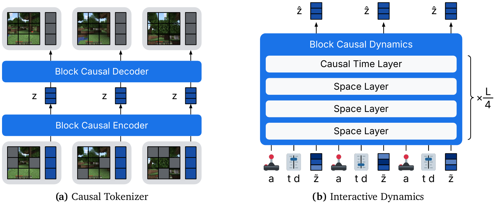

# 12 — Dreamer 4: Training Agents Inside of Scalable World Models (2025)

- 论文：arXiv:2509.24527（Danijar Hafner et al., DeepMind）
- **官方代码未发布**。可用的实现：
  - `https://github.com/lucidrains/dreamer4`（PyTorch，有 action-conditioned moving-MNIST 的可跑示例，`pip install dreamer4`）
  - `https://github.com/nicklashansen/dreamer4`（非官方 PyTorch，后被作者本人的 "Hallucination in World Models" 仓库替代，据称训练配方更好）

## 为什么重要

把 Dreamer 系列从 **online RL**（必须和环境交互）推到 **纯离线**：

> 只给一批离线视频 + 动作数据，训出世界模型，然后**完全在想象里**训策略，策略直接在真环境里工作。

在 Minecraft 上实现了从离线数据学会「挖钻石」这个长程任务，不需要环境交互、不需要在线探索。

## 架构



<small>原文 Figure 2，Hafner et al., *Training Agents Inside of Scalable World Models* (arXiv:2509.24527)。版权归原作者，此处为学习笔记引用。</small>

**怎么读这张图**（两个面板，共用同一套 block-causal transformer 架构，这是本文的一个卖点）：

- **(a) Causal Tokenizer**：底部是输入帧（注意每帧旁边有**灰色竖条**——那是被 mask 掉的图像 patch，tokenizer 用 masked autoencoding 训）。向上经 **Block Causal Encoder** 压成 `z`（蓝色小方块），再经 **Block Causal Decoder** 重建。关键在"Causal"：**第 t 帧的 token 只能看见 ≤ t 的帧**，所以解码时可以逐帧吐出，不必等整段
- **(b) Interactive Dynamics**：底部那一排 `a t d z a t d z …` 是**交错的输入序列**——`a` 动作、`t` 任务 token、`d` 步长/噪声水平、`z` 表征。往上进 **Block Causal Dynamics**，内部是 `Causal Time Layer` + 三个 `Space Layer` 的堆叠，右侧标注 **`× L/4`** 表示这组 4 层重复 L/4 次
- **注意层的配比**：时间层只有 1 个、空间层有 3 个。时间注意力贵（跨帧），空间注意力便宜（帧内），所以 1:3 是成本折中

两个设计要点：

### 1) Block-causal attention

帧内双向 + 帧间因果：

```
帧内（Space Layer）：  全注意力，同一帧的 token 互相可见
跨帧（Causal Time Layer）：causal，只能看过去
```

既保留帧内空间全局建模能力，又支持逐帧自回归交互。这是交互式世界模型的标准注意力结构（Oasis、Matrix-Game 都类似，见 note 10）。

### 2) Shortcut forcing（本文核心技术）

三层叠加，理解顺序是：

| 技术 | 解决什么 | 代价 |
|---|---|---|
| **Diffusion Forcing** | 每帧独立噪声水平 → 训练目标等价于自回归推理（见 note 10） | 每帧仍需多步去噪 |
| **Shortcut models** | 把**步长 d** 也作为条件输入，训练时加自一致性约束，让模型学会"一步跨过多个去噪步" | 需要额外的自一致性损失 |
| **Shortcut forcing** = 两者结合 | **自回归 + 极少步（~4 步）生成**，单 GPU 接近实时 | — |

图 (b) 底部序列里那个 `d` 就是步长条件。

对比同类做法：

- DIAMOND 用 EDM 的 n=3 步（note 08）—— 靠参数化让少步稳定
- GameNGen 用蒸馏后的 4 步 DDIM（note 10）—— 训完再蒸馏
- **Dreamer 4 把少步能力直接写进训练目标** —— 不需要额外的蒸馏阶段

## 数据

- **OpenAI VPT 的 Minecraft contractor 数据**，约 2500 小时人类游玩录像（带键鼠动作标注）
- 关键设定：**offline-only**。不允许在训练过程中与 Minecraft 交互采新数据
- 也在小规模可控数据（bouncing square 之类）上做验证

对比 DreamerV3 挖钻石用了 1e8 级别的在线交互——这是从"模型帮我省样本"到"**我压根不需要环境**"的质变。

## 训练方法：三阶段

原文 Algorithm 1：

```
Phase 1: World Model Pretraining
  - 在视频上训 tokenizer（masked autoencoding）
  - 在 tokenized 视频 + （可选的）动作上训 dynamics
  - shortcut forcing 目标：扩散损失 + 自一致性损失

Phase 2: Agent Finetuning
  - 把 policy head 和 reward head 接到同一个 backbone 上
  - 通过在 dynamics transformer 里插入 task token 来微调
  - 用离线数据做行为克隆式的初始化

Phase 3: Imagination Training
  - 从离线数据的状态出发，用世界模型 rollout
  - 优化 policy head 和 value head（Dreamer 风格 λ-return）
  - 完全不碰真环境
```

**Phase 2 的姿态变化值得单独记**：policy head 和 reward head **直接长在世界模型的 backbone 上**，共享表征，而不是另起一个网络。"把 agent 训在世界模型里面"这个标题是字面意思。原文还提到所有损失项按 **RMS 的运行估计归一化**——这是 DreamerV3 那条"尺度对齐"暗线的延续（见 note 05 和 note 00 的暗线四）。

## 与 DreamerV3 的对照

| | DreamerV3 | Dreamer 4 |
|---|---|---|
| 表征 | RSSM（GRU + categorical latent） | causal tokenizer + Transformer latent |
| 动态 | 一步预测分布 | 少步扩散（shortcut forcing） |
| 注意力 / 递推 | GRU 递推 | block-causal attention |
| 数据 | online replay，需环境交互 | **纯离线** |
| 策略 | 独立 actor-critic 网络 | 与 WM 共享 backbone 的 head |
| 想象内 RL | ✅ | ✅（原封不动继承） |
| Minecraft 钻石 | 需 1e8 在线步 | 离线数据 + 想象 |
| 实时交互 | 不是目标 | 支持（原文 Figure 5 有人类实时交互演示） |

注意最后一行：Dreamer 4 把"**可被人实时操作**"也做成了能力。这在 Dreamer 系里是新的，更接近 note 10 那类神经游戏引擎。

## 复现建议

官方无代码，不要指望一次复现论文结果。

- `lucidrains/dreamer4` 适合**学架构**：它有一个 action-conditioned moving MNIST / bouncing square 的最小示例，能在单卡几小时内看到"世界模型确实跟随动作"，是验证自己理解的好 sanity check
- `nicklashansen/dreamer4` 更偏实际训练配方（更大数据和模型）

想用在自己任务上，最小可行路径：

1. 准备 (frame, action) 配对数据，动作离散化或做线性 embedding
2. 用现成 image VAE 做 tokenizer，**确认没有时间压缩**（见 note 10 的硬约束）
3. block-causal Transformer + Diffusion Forcing（每帧独立噪声水平）先跑通多步预测
4. 确认跟随动作后，再加 shortcut forcing 做加速
5. 最后才接想象内 RL

顺序很重要：**先确认世界模型听动作，再谈策略**。反过来做的话，策略学不好你分不清是模型不听话还是 RL 没调好。
